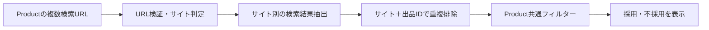
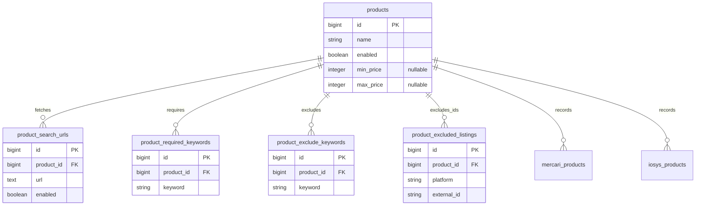

# Productの計測設定を検索URL起点へ変更する

更新: 2026-11-04。

## 基本仕様

**Productに共通フィルターを一度設定し、配下へ複数の検索結果URLを登録する。**

- Product: 名前、任意カテゴリ、有効/停止、任意の価格帯・必須語・除外語・個別出品除外。
- ProductSearchUrl: 検索結果URL、有効/停止。サイトは取得時にURLから判定する。
- 同じサイトの複数URLも登録できる。条件をサイトごと・URLごとに再入力しない。
- 検索結果URLのみを受け付ける。URLのページ種別やサイト識別子をDBへ重複保存しない。
- Productとは別の計測エンティティを作らない。

価格帯は上下限それぞれ任意で両端を含む。必須語はすべて含む、除外語はいずれかを含めば不採用。個別除外はサイト＋出品IDで指定し、別URLから同じ出品を発見しても除外する。

URLは取得範囲、共通フィルターは取得後の採用条件。URLが5万円以下なら、共通上限を10万円にしても取得範囲は広がらない。両者を自動同期しない。

## UI

1. Productの名前を入力する。
2. 検索結果URLを複数追加する。通常のサイト選択は不要。
3. 必要なら共通フィルターを一度だけ入力する。
4. 手動取得でURLごとの成功/失敗、重複排除後の採用/不採用を確認する。
5. Productの設定として保存し、後から編集・削除する。

個別出品除外は結果から追加し、設定内で取り消す。1 URLの失敗は他URLの成功を妨げない。条件変更後は古いプレビューを消して再取得を促す。

PoC画面は `/admin/products/search-settings`。既存の計測対象管理からもURLで登録したProductの設定へ移動できる。

## 取得の流れ

ホストで判定できるサイトはホストで判定する。複数サイトが同じホストを使う場合だけ、パス・クエリも見る。URLから任意のクラス名を生成せず、アプリ側の固定対応表から抽出処理を選ぶ。

現行のYahoo系生成器はオークションとフリマで同じホストを使い、abatch等で分けている。Yahoo対応時は実URLで判定規則を確認する。今回のPoCではメルカリ・イオシスを対象とする。

サイト識別と通信方式は別の責務。PoCでは公開IPに接続先を固定したHTTP取得とHTML解析を使う。JavaScript描画が必要なページは取得失敗として示し、実績を確認してから既存ブラウザ方式へ接続する。通信先・リダイレクト・応答サイズ・処理時間の制限は設ける。

## ER・スキーマ

既存カテゴリ関連・日次集計・他サイトの出品・共通timestampsは図から省略。既存Productと出品のID・関連は維持する。価格NULLは制限なし、0円とは区別する。

子のproduct_idはNOT NULL FK。語句はProduct＋語句、個別除外はProduct＋サイト＋出品IDで一意。個別除外のサイト識別子は、サイト間で同じ出品IDがある場合を区別するために必要。URLには保存しない。

Productと子設定は同一トランザクションで更新する。保存・取得で同じ入力検証を使い、保存できるが取得できない件数制限等の不整合を防ぐ。

## PoCの範囲

- Productへの保存・編集・削除、複数検索URLの手動取得、共通条件の採否を実装する。
- 最大5 URL、各URLは先頭1ページ・最大100件。全体45秒、1 URL20秒を上限とする。
- 取得結果・実行履歴はまだ保存しない。実行履歴・条件改訂テーブルは作らない。
- 既存Productのサイト別設定は当面維持する。URLで登録したProductには不要な旧設定を作らず、旧ジョブは対応する旧設定があるProductだけを対象とする。
- 定期取得、相場画面への取得結果反映、売切れ追跡、通知、一括移行は手動取得の結果を確認してから接続する。

## 既存設定の移行時に決めること

- サイトごとの価格帯・必須語・除外語が違う場合、勝手にAND/OR統合しない。共通条件を選び直すかProductを分ける。
- 個別出品除外はサイト付きで移す。
- Product・出品・過去集計を削除しない。共通フィルターを旧サイト別設定へ重複保存しない。
- 旧InspectorによるProduct単位の削除を新方式へ流用しない。複数URLの結果を二重集計しない。

## 確認事項

CRUD、不正な設定でのロールバック、価格境界、必須語AND/除外語OR、サイト付き個別除外、重複排除、URL別失敗、停止URL、取得上限と通信先、旧ジョブへの回帰をテストする。

操作・取得制限・検証結果は [検索URLによるProduct計測PoC](docs/backend/product-search-poc.md)、DBの現行定義は [schema.rb](volumes/backend/db/schema.rb) を参照する。

Orcaの `gpt-6-luna` / high ワーカーでDB/API・取得/採否・UIを分担し、別ワーカーでレビューする。fastの適用は未確認。
