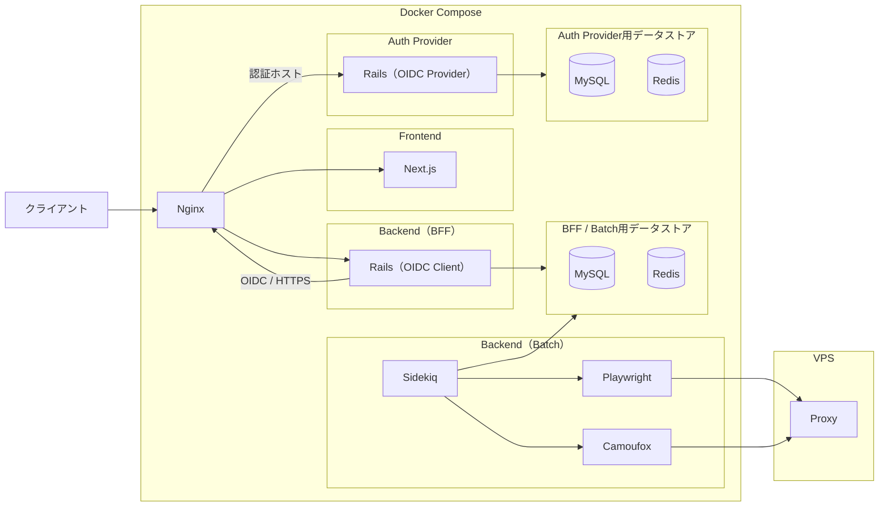
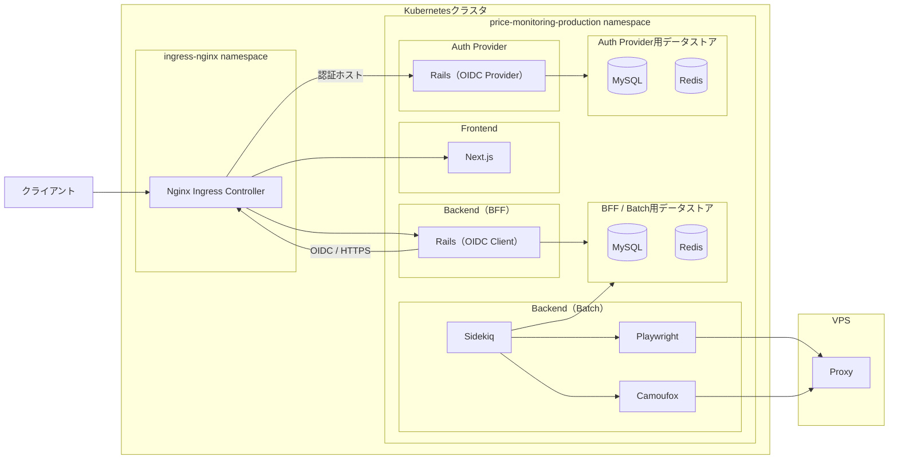
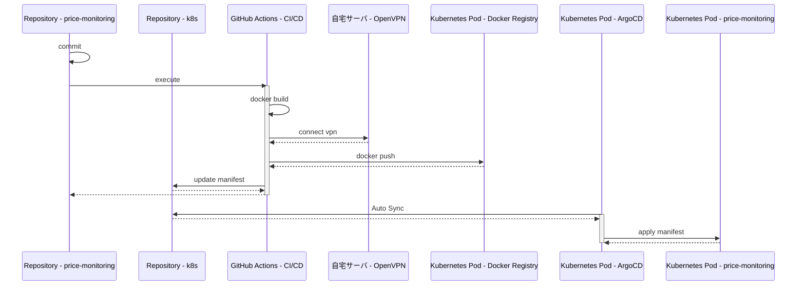

# price-monitoring

[](https://github.com/kuroweb/price-monitoring/actions/workflows/cicd-integration.yml) [](https://github.com/kuroweb/price-monitoring/actions/workflows/cicd-production.yml)

- Web上にある商品の最安値を探したり、相場を把握するためのツール
- Rails, TypeScriptのキャッチアップが主な開発目的
- DatadogやBugSnagを導入して運用監視についてのキャッチアップも兼ねている

## 技術スタック

### Frontend

- Next.js
- TypeScript
- TailwindCSS

### Backend

- Rails
- OpenID Connect（実装中）

### 運用監視

- Datadog
- BugSnag

## インフラ構成

### Development

Docker Composeで各コンテナを起動する。



### Production

自宅のKubernetesクラスタ（Master Node × 1、Worker Node × 3）で稼働する。アプリは同じnamespaceで管理し、BFF / BatchとAuth ProviderのMySQL・Redisは分ける。

Integrationも同じ構成で、アプリのnamespaceは`price-monitoring-integration`を使用する。



## セットアップ手順

- nginx用の証明書発行
  - mkcertをインストール

    ```bash
    $ brew install mkcert
    $ mkcert -install
    ```

  - 証明書発行

    ```bash
    $ mkcert \
      -cert-file ./volumes/nginx/certs/fullchain.pem \
      -key-file ./volumes/nginx/certs/privkey.pem \
      dev.price-monitoring.com
    ```

  - /etc/hosts に以下を記述

    ```bash
    127.0.0.1 dev.price-monitoring.com dev.auth-provider.com
    ```

- 認証アプリの秘密鍵・証明書・hosts・OIDCクライアントを準備する。既存環境からの引き継ぎも含め、[認証基盤のセットアップ](docs/auth-provider/overview.md)を参照する。

- Dockerイメージビルド

  ```bash
  $ docker compose build
  ```

- コンテナ起動

  ```bash
  $ just up
  ```

- コンテナ停止

  ```bash
  $ just down
  ```

- ローカル環境
  - メインアプリ: https://dev.price-monitoring.com/
  - 認証プロバイダー: https://dev.auth-provider.com/

## テスト

起動中の対象コンテナで RSpec を直接実行する。ファイル・行・RSpec オプションを引数で指定できる。

```bash
just rspec-backend
just rspec-auth-provider
```

認証アプリのテスト DB・アセットの初回準備は[認証基盤のセットアップ](docs/auth-provider/overview.md)を参照する。

## Docs

- [`docs/database/overview.md`](docs/database/overview.md) — database 設計の見取り図
- [`docs/database/er.md`](docs/database/er.md) — テーブル定義（カラム・インデックス）
- [`docs/database/association.md`](docs/database/association.md) — テーブル間リレーション（Mermaid）
- [`docs/auth-provider/overview.md`](docs/auth-provider/overview.md) — 認証基盤の配置・セットアップ・既存環境の引き継ぎ
- [`docs/backend/overview.md`](docs/backend/overview.md) — Rails BFF / batch の責務分離
- [`docs/backend/operations/rails-upgrade.md`](docs/backend/operations/rails-upgrade.md) — Rails バージョンアップ手順
- [`docs/frontend/overview.md`](docs/frontend/overview.md) — Next.js frontend の責務分離

## PR の自動レビュー

`.github/workflows/claude-code-review.yml` で Claude Code による自動レビューを実行する。

- PR の作成、更新、再オープン、Draft 解除時に実行する。Draft 中は実行しない。
- `kuroweb/ai-manifest` の `gh-pr-review-ci` と `code-reviewing` スキルを使い、Sonnet が PR の説明と差分をレビューする。
- レビュー結果は PR のコメントに投稿する。同じ PR に更新が入った場合、実行中のレビューをキャンセルする。

事前にリポジトリの Settings → Secrets and variables → Actions に `CLAUDE_CODE_OAUTH_TOKEN` を登録する。`GITHUB_TOKEN` は GitHub Actions が自動発行するものを使う。

## 自動デプロイ

- ArgoCDによるGitOps
- [k8sマニフェスト](https://github.com/kuroweb/k8s)



## Docs

### seedファイル

すべてのSeedを投入する

```bash
rails db:seed -e {environment}
```

特定のSeedを投入する([rakeタスク拡張](/volumes/backend/lib/tasks/seed.rake))

```bash
rails db:seed:{seed_name} -e {environment}
```
