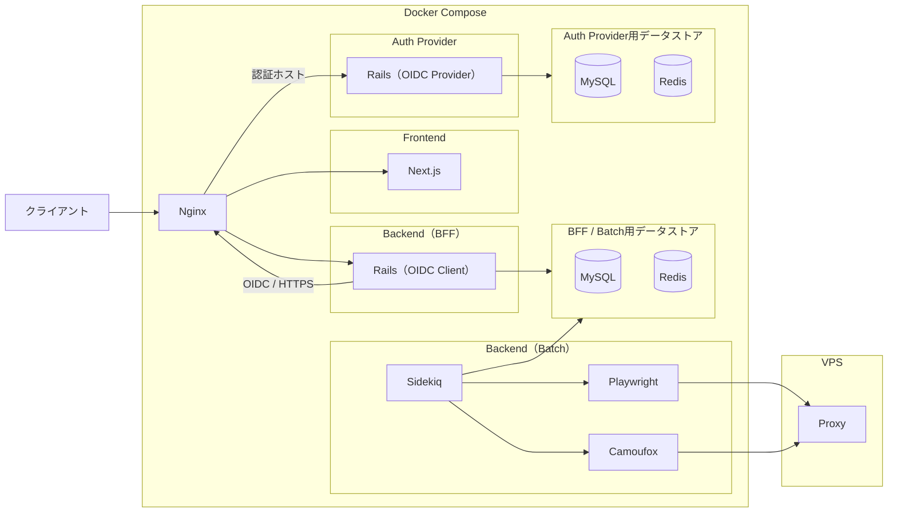
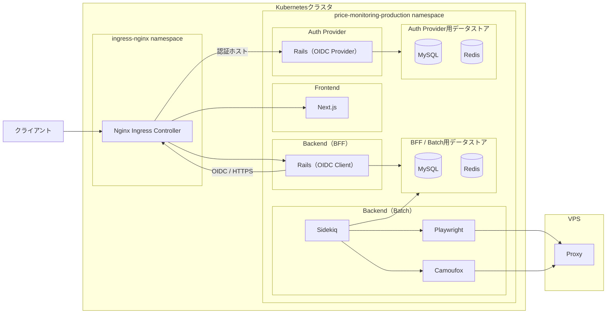

# price-monitoring

 

- Web上にある商品の最安値を探したり、相場を把握するためのツール
- Rails, TypeScriptのキャッチアップが主な開発目的
- DatadogやBugSnagを導入して運用監視についてのキャッチアップも兼ねている

## 技術スタック

### Frontend

- Next.js
- TypeScript
- TailwindCSS

### Backend

- Rails
- OpenID Connect（実装中）

### 運用監視

- Datadog
- BugSnag

## インフラ構成

### Development

Docker Composeで各コンテナを起動する。

### Production

自宅のKubernetesクラスタ（Master Node × 1、Worker Node × 3）で稼働する。アプリは同じnamespaceで管理し、BFF / BatchとAuth ProviderのMySQL・Redisは分ける。

Integrationも同じ構成で、アプリのnamespaceは`price-monitoring-integration`を使用する。

## 開発・運用の入口

初めて開発する場合は [ローカル開発ガイド](docs/development/index.md) の順に、証明書・hosts・環境変数・DB・認証クライアントを準備する。
アプリのディレクトリから読み始める場合は [backend](volumes/backend/README.md) / [frontend](volumes/frontend/README.md) / [auth-provider](volumes/auth-provider/README.md) を参照する。

- [セットアップ・日常操作・依存関係・テスト](docs/development/index.md)
- [認証固有の準備・既存環境の引き継ぎ・検証](docs/auth-provider/index.md)
- [Seed データの投入](docs/backend/operations/seeds.md)
- [CI/CD・PR 自動レビュー・手動デプロイ](docs/cicd/index.md)

## Docs

[文書ガイド・索引](docs/index.md) に、README・AGENTS.md・docs・アプリ別 README の読み手、書く内容、話題ごとの正本と外部事例の採用判断をまとめている。

- [Backend の責務分離](docs/backend/index.md)
- [Frontend の責務分離](docs/frontend/index.md)
- [Database 設計](docs/database/index.md)
- [AI エージェント向け開発規約](AGENTS.md)
