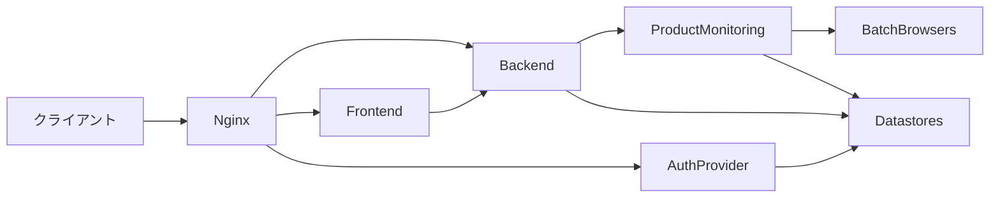
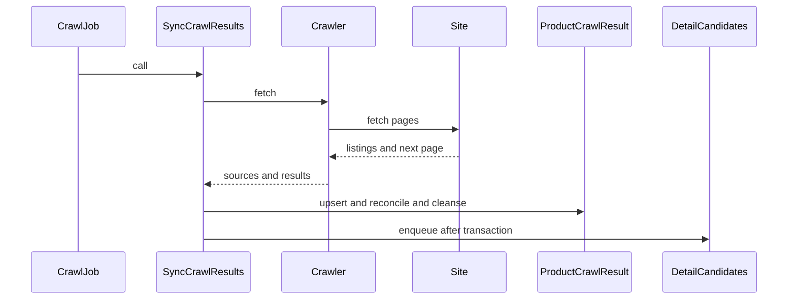

# Architecture
 
2026-11-15 の重点再調査で確認した範囲は reverse-engineering-timestamp.md を参照。それ以外の記述は以前の調査記録であり、今回の深い検証対象外。

## Architecture Analysis

### System Overview

一つのリポジトリに、画面、BFF、バッチ、OIDC Provider、取得用ブラウザが入る。開発は Docker Compose、本番は自宅 Kubernetes と ArgoCD である。マニフェストの正本は別リポジトリ `k8s` の `manifests/price-monitoring` にある。BFF 用の MySQL / Redis と Provider 用の MySQL / Redis は分けている。

商品計測は BFF と同じ Rails アプリの `ProductMonitoring` にあり、Sidekiq が取得と集計を実行する。HTML の取得は Playwright 経由で、動的プロキシの先へ出る。

### Architectural Style

モジュラモノリスに、認証とブラウザ取得を別プロセスで足した構成。画面と BFF はデプロイ単位が分かれる。商品計測・従来クロール・Backmarket は同じ Rails プロセスと同じ MySQL に同居する。

### Component Relationships

<!-- text fallback: クライアントは Nginx を経由して Frontend、Backend、Auth Provider へ届く。Frontend は Backend の API を呼ぶ。Product Monitoring は Backend 内にあり、Batch Browsers と Datastores を使う。Auth Provider は自分の Datastores を使う。 -->

### Data Flow

`CrawlJob` は保存済み設定で `SyncCrawlResults` を呼ぶ。`Crawler` は `UrlRouter` とサイトクラスを使って取得元ごとに最大5ページを取得し、取得状況と出品にフィルタ判定を付ける。保存処理は条件に合う出品の upsert、サイト別の売切れ同期、条件外行の削除をトランザクションで行い、その後、個別確認を投入する。

### Key Design Decisions

サイトごとに一覧・詳細の判定が異なる。イオシスとじゃんぱらの消失判定は対象サイトの全取得成功かつ未打ち切りを要求する。一方、詳細確認候補の選択では打ち切りでも確認できる。表示と集計は保存済みの結果を使う。

### Improvement Opportunities

取得結果のハッシュ契約と販売状態遷移の依存を明示すると変更影響を追いやすい。同一性は Crawler・集計が external_id、表示が platform と external_id、DB 一意制約が設定と external_id であり、整理は仕様と既存データの検討を伴う。

## Interaction Diagrams

<!-- Text fallback: ジョブが取得と保存を呼び、サイト別取得の結果を保存してから個別確認を投入する。 -->
