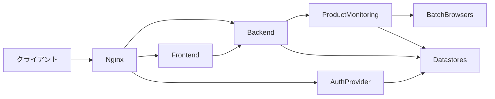

# Architecture

## Architecture Analysis

### System Overview

一つのリポジトリに、画面、BFF、バッチ、OIDC Provider、取得用ブラウザが入る。開発は Docker Compose、本番は自宅 Kubernetes と ArgoCD である。マニフェストの正本は別リポジトリ `k8s` の `manifests/price-monitoring` にある。BFF 用の MySQL / Redis と Provider 用の MySQL / Redis は分けている。

商品計測は BFF と同じ Rails アプリの `ProductMonitoring` にあり、Sidekiq が取得と集計を実行する。HTML の取得は Playwright 経由で、動的プロキシの先へ出る。

### Architectural Style

モジュラモノリスに、認証とブラウザ取得を別プロセスで足した構成。画面と BFF はデプロイ単位が分かれる。商品計測・従来クロール・Backmarket は同じ Rails プロセスと同じ MySQL に同居する。

### Component Relationships



<!-- text fallback: クライアントは Nginx を経由して Frontend、Backend、Auth Provider へ届く。Frontend は Backend の API を呼ぶ。Product Monitoring は Backend 内にあり、Batch Browsers と Datastores を使う。Auth Provider は自分の Datastores を使う。 -->

### Data Flow

商品計測の保存は `ProductMonitoring::CrawlJob` から `SyncCrawlResults` へ入る。`Crawler` が `UrlRouter` でサイトを決め、`Sites::*#fetch` が HTML を出品ハッシュにする。採用した出品は `product_crawl_results` へ upsert され、続けて `CleanseCrawlResults` が現在の必須語・除外語・価格帯に合わない行を消す。トランザクションのあと `DetailCandidates` が個別確認ジョブを積む。

表示側は `WatchListings` が `LowestListings.candidates` の `sold: false` を価格順に読み、条件に合う重複のない 8 件で止める。

### Key Design Decisions

- コントローラは入出力、複数モデルの手順は service、非同期の入口は `app/sidekiq`（`docs/backend/index.md`）
- 商品計測のサイト差は `ProductMonitoring::Sites` に閉じ、共通のページ送りとブラウザ取得は `Crawler`、`Sites::BrowserPage`、`Sites::Pagination`
- 個別確認の対象サイトは、クラスが `fetch_detail` を持つかどうかだけで決まる
- 検索結果に出なかった出品は、条件に合っていれば残す（`docs/backend/product-monitoring-poc.md`）
- じゃんぱらの一覧解析は販売状態を見ず、抽出した出品へ `sold: false` を付ける

### Improvement Opportunities

`docs/database/index.md` は `product_crawl_results` をまだ領域として書いていない。管理 API は会員ごとの認可を持たない。従来クロールと商品計測クロールが同じプラットフォーム名で並ぶ。いずれも観測した差分であり、販売状態の変更手順はここには書かない。

## Interaction Diagrams

取得から販売中表示まで。じゃんぱらは個別確認に入らない。

```mermaid
sequenceDiagram
  participant job as CrawlJob
  participant sync as SyncCrawlResults
  participant site as SitesJanpara
  participant db as ProductCrawlResult
  participant details as DetailCandidates
  participant ui as Frontend
  job->>sync: call
  sync->>site: fetch
  site-->>sync: sold false
  sync->>db: upsert and update_sold
  sync->>details: enqueue
  details-->>job: no fetch_detail
  ui->>db: WatchListings sold false
```

<!-- text fallback: CrawlJob が SyncCrawlResults を呼ぶ。Sites::Janpara は sold false の出品を返す。SyncCrawlResults は ProductCrawlResult を upsert し、今回の ID だけ update_sold する。DetailCandidates は fetch_detail の無いじゃんぱらを個別確認へ入れない。Frontend の商品モニタリングは sold false の行を販売中として読む。 -->

メルカリと Yahoo!フリマでは、一覧のあと `CrawlDetailJob` が `fetch_detail` を呼び、同じ `platform` と `external_id` の行の `sold` を一括更新する。`deleted: true` のときは行を消す。`sold` キーが無いときは `updated_at` だけを進める。
