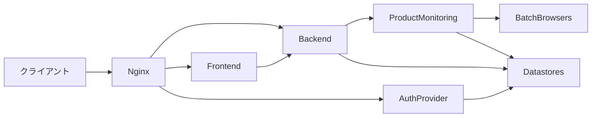
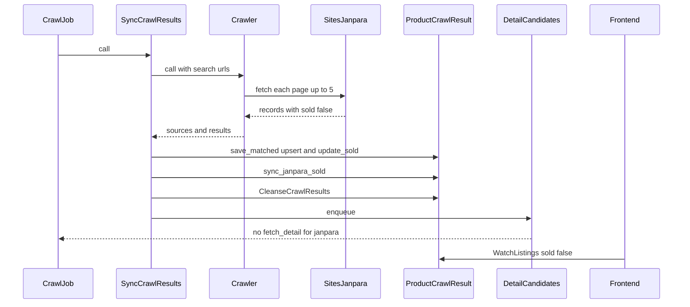
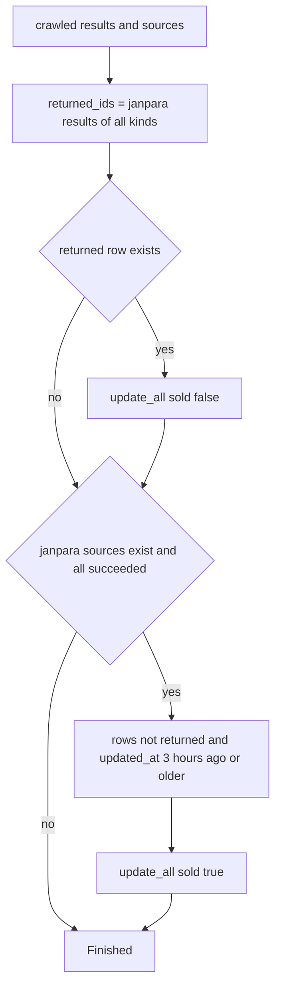

# Architecture

> この文書は調査時点の記録であり、その後の販売状態同期の変更を反映していない。現行動作は `docs/features/product-monitoring/index.md` を参照する。

## Architecture Analysis

### System Overview

一つのリポジトリに、画面、BFF、バッチ、OIDC Provider、取得用ブラウザが入る。開発は Docker Compose、本番は自宅 Kubernetes と ArgoCD である。マニフェストの正本は別リポジトリ `k8s` の `manifests/price-monitoring` にある。BFF 用の MySQL / Redis と Provider 用の MySQL / Redis は分けている。

商品計測は BFF と同じ Rails アプリの `ProductMonitoring` にあり、Sidekiq が取得と集計を実行する。HTML の取得は Playwright 経由で、動的プロキシの先へ出る。

### Architectural Style

モジュラモノリスに、認証とブラウザ取得を別プロセスで足した構成。画面と BFF はデプロイ単位が分かれる。商品計測・従来クロール・Backmarket は同じ Rails プロセスと同じ MySQL に同居する。

### Component Relationships

<!-- text fallback: クライアントは Nginx を経由して Frontend、Backend、Auth Provider へ届く。Frontend は Backend の API を呼ぶ。Product Monitoring は Backend 内にあり、Batch Browsers と Datastores を使う。Auth Provider は自分の Datastores を使う。 -->

### Data Flow

商品計測の保存は `ProductMonitoring::CrawlJob` から `SyncCrawlResults` へ入る。`Crawler` が `UrlRouter` でサイトを決め、`Sites::*#fetch` が HTML を出品ハッシュにする。`Crawler` は URL ごとに最大 5 ページ・1 ページ 100 件まで読み、同じ `external_id` は最初の 1 件だけ残し、`Filter` の理由（価格帯・必須語・除外語・除外出品）を付けて `{ sources, results }` を返す。

`SyncCrawlResults#call` は次の順に動く。

1. 理由が空または `excluded_listing` だけの結果を `matched` とする
2. `DetailCandidates#newly_sold` で、`fetch_detail` を持つサイトの新規売り切れを数える
3. トランザクション内で `save_matched`（価格 nil を捨て、`upsert_all` と `update_sold`）、`sync_janpara_sold`（`crawled` 全件を使うじゃんぱら専用の販売状態の調整）、`CleanseCrawlResults`（現在の条件に合わない行の削除）を順に行う
4. トランザクションのあと `DetailCandidates#enqueue` が個別確認ジョブを積む

`sync_janpara_sold` が `save_matched` の後にあるため、じゃんぱらの行の `sold` は常にこちらの結果が最終になる。検索に返った行は `false`、返らず 3 時間以上たった行は、じゃんぱらの source がすべて成功しているときに限り `true` である。

表示側は `WatchListings` が `LowestListings.candidates` の `sold: false` を価格順に読み、条件に合う重複のない 8 件で止める。

### Key Design Decisions

- コントローラは入出力、複数モデルの手順は service、非同期の入口は `app/sidekiq`（`docs/backend/index.md`）
- 商品計測のサイト差は `ProductMonitoring::Sites` に閉じ、共通のページ送りとブラウザ取得は `Crawler`、`Sites::BrowserPage`、`Sites::Pagination`
- 個別確認の対象サイトは、クラスが `fetch_detail` を持つかどうかだけで決まる
- 検索結果に出なかった出品は、条件に合っていれば残す（`docs/backend/product-monitoring-poc.md`）
- じゃんぱらの一覧解析は販売状態を見ず、抽出した出品へ `sold: false` を付ける。販売状態は保存側の `sync_janpara_sold` が、検索への出現と消失だけから決める
- 汎用の `update_sold` は売り切れを販売中へ戻さない（`sold: false` の結果は既存が nil の行だけを更新する）。じゃんぱらだけが、検索に返った行を結果の値に関係なく `false` へ戻す
- 検索から消えた行の売り切れ化は、じゃんぱらは `SyncCrawlResults`、メルカリと Yahoo!フリマは `DetailCandidates` と `CrawlDetailJob` が担う。イオシス、トレファク、ヤフオクには無い
- 3 時間の待ち（`DetailCandidates::DETAIL_RECHECK_INTERVAL`）は、個別確認とじゃんぱらの売り切れ化で共有する

### Improvement Opportunities

`docs/database/index.md` は `product_crawl_results` をまだ領域として書いていない。管理 API は会員ごとの認可を持たない。従来クロールと商品計測クロールが同じプラットフォーム名で並ぶ。`docs/backend/product-monitoring-poc.md` は、検索から消えたじゃんぱらを売り切れにする処理を書いていない。1 URL の取得は 5 ページ・500 件で打ち切られるが、じゃんぱらの売り切れ化はそれを区別せず、打ち切りで返らなかった出品を売り切れにする余地がある。いずれも観測した差分であり、販売状態の変更手順はここには書かない。

## Interaction Diagrams

取得から販売中表示まで。じゃんぱらは個別確認に入らず、`SyncCrawlResults` 内で販売状態が決まる。

<!-- text fallback: CrawlJob が SyncCrawlResults を呼ぶ。SyncCrawlResults は Crawler に検索 URL を渡し、Crawler は Sites::Janpara の fetch を最大 5 ページ呼んで sold false の出品と取得元の状態を返す。SyncCrawlResults は価格のある結果を upsert して update_sold し、続けて sync_janpara_sold が検索に返った行を false、消えた行を true にし、CleanseCrawlResults が条件に合わない行を消す。DetailCandidates は fetch_detail の無いじゃんぱらを個別確認へ入れない。Frontend の商品モニタリングは sold false の行を販売中として読む。 -->

`sync_janpara_sold` の分岐。

<!-- text fallback: sync_janpara_sold は、crawled の全結果からじゃんぱらの ID を集め、検索に返った既存行を sold false にする。そのあと、じゃんぱらの source が 1 件以上あり全件成功していれば、返らなかった行のうち最終更新から 3 時間以上たったものを sold true にする。それ以外は何もしない。 -->

メルカリと Yahoo!フリマでは、一覧のあと `CrawlDetailJob` が `fetch_detail` を呼び、同じ `platform` と `external_id` の行の `sold` を一括更新する。`deleted: true` のときは行を消す。`sold` キーが無いときは `updated_at` だけを進める。
