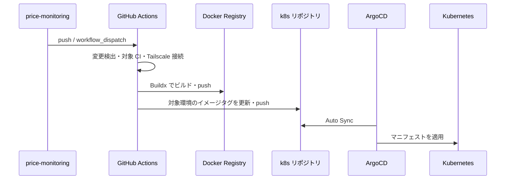

# CI/CD と自動レビュー

開発・運用担当者向けに、このリポジトリの GitHub Actions の実行条件とデプロイ経路をまとめる。
実行条件の正本はリンク先の workflow。ローカル操作は [ローカル開発](../development/index.md) を参照する。

## 環境と実行契機

| 環境 | CI/CD workflow | 自動実行 | 全イメージの手動デプロイ |
| --- | --- | --- | --- |
| Integration | [cicd-integration.yml](../../.github/workflows/cicd-integration.yml) | `develop` への push | [deploy-integration.yml](../../.github/workflows/deploy-integration.yml) |
| Production | [cicd-production.yml](../../.github/workflows/cicd-production.yml) | `master` への push | [deploy-production.yml](../../.github/workflows/deploy-production.yml) |

CI/CD は `workflow_dispatch` による手動実行にも対応する。全イメージの手動デプロイは `workflow_dispatch` のみ。

## Pull Request の自動テスト

[ci-pr.yml](../../.github/workflows/ci-pr.yml) は、Pull Request の作成・更新・再オープン時に、変更されたアプリのテストを実行する。送信先ブランチや作成者による制限はなく、Dependabot が作成した Pull Request も対象となる。

| 変更対象 | 実行するテスト |
| --- | --- |
| `volumes/backend/**` / `containers/backend/**` | `backend` コンテナでテスト DB を準備し、RSpec を実行 |
| `volumes/auth-provider/**` / `containers/auth-provider/**` | `auth-provider` コンテナでテスト DB と Tailwind アセットを準備し、RSpec を実行 |
| `volumes/frontend/**` / `containers/frontend/**` / `.github/workflows/cicd-integration.yml` / `.github/workflows/cicd-production.yml` | `frontend` コンテナで `npm ci` 後、lint・型検査・Vitest を実行 |
| `docker-compose.yml` / `.github/workflows/ci-pr.yml` | 上記すべての検証を実行 |

Frontend CI は `--no-deps` で実行し、BFF・DB・認証の起動を必要としない。Playwright・Camoufox の独立したテストジョブは定義していない。同じ Pull Request に更新が入った場合は、実行中のテストをキャンセルして最新の変更を検証する。

この workflow はリポジトリのシークレットを必要とせず、デプロイ処理を含まない。マージ後は「環境と実行契機」の push による CI/CD が実行される。

## Dependabot による依存関係の更新

[dependabot.yml](../../.github/dependabot.yml) をデフォルトブランチの `master` に配置すると、以下の依存関係を週次で確認し、更新する Pull Request を `master` 向けに作成する。

| 対象 | 依存関係ファイル |
| --- | --- |
| BFF / batch | `volumes/backend/Gemfile` / `Gemfile.lock` |
| Provider | `volumes/auth-provider/Gemfile` / `Gemfile.lock` |
| Frontend | `volumes/frontend/package.json` / `package-lock.json` |
| GitHub Actions | `.github/workflows/*.yml` |

マイナー・パッチ更新は対象ごとに一つの Pull Request にまとめ、メジャー更新は個別に作成する。通常のバージョン更新で同時に開く Pull Request は、各対象で最大 5 件とする。この上限と週次スケジュールはセキュリティ更新の実行頻度・件数を制御するものではない。

BFF / batch と Provider の更新では「Pull Request の自動テスト」に従って RSpec が動き、Frontend の更新では lint・型検査・Vitest が動く。ローカルでの確認は [テスト手順](../development/index.md#テスト)を参照する。Dependabot の更新 PR も「PR の自動レビュー」の対象となる。

Docker イメージと Dockerfile 内の `npm install` / `pip install` は、この設定の対象に含めない。Playwright は Ruby gem・イメージ・インストールコマンドにバージョン指定が分散しているため、`playwright-ruby-client` の更新では関連する指定の整合性も確認する。

Dependabot alerts とセキュリティ更新 PR の自動作成は、GitHub のリポジトリ設定で別途有効化する。設定項目の意味は [GitHub の公式資料](https://docs.github.com/en/code-security/reference/supply-chain-security/dependabot-options-reference)を参照する。

## 変更検出と CI/CD

| 対象 | 変更検出するパス | CI | CD |
| --- | --- | --- | --- |
| BFF / batch | `volumes/backend/**` / `containers/backend/**` | `backend` コンテナで DB 作成・migration・RSpec | CI 成功後、spec 以外のアプリファイルまたはコンテナ定義の変更時 |
| Provider | `volumes/auth-provider/**` / `containers/auth-provider/**` | `auth-provider` コンテナでテスト DB・Tailwind アセット準備・RSpec | CI 成功後、spec 以外のアプリファイルまたはコンテナ定義の変更時 |
| Frontend | `volumes/frontend/**` / `containers/frontend/**` | `frontend` コンテナで `npm ci`・lint・型検査・Vitest | CI 成功後、変更検出時 |
| Playwright | `containers/backend_playwright/**` | 独立した CI ジョブなし | 変更検出時 |
| Camoufox | `containers/backend_camoufox/**` | 独立した CI ジョブなし | 変更検出時 |

CI/CD の手動実行では変更の有無にかかわらず各ジョブを実行する。BFF / Provider / Frontend の CD はそれぞれの CI 成功が前提。
Frontend CI は `docker-compose.yml` と各環境自身の CI/CD workflow の変更時にも実行する。これらだけの変更では Frontend CD は実行しない。
spec 以外の判定など正確な glob は workflow の `check_changes` を参照する。

CD の共通処理は [reusable-cd.yml](../../.github/workflows/reusable-cd.yml) に定義している。

1. GitHub Actions runner を Tailscale に接続する。
2. runner の make / Docker Buildx で対象イメージをビルドする。`cache=true` / `push=true` により GitHub Actions キャッシュを利用し、レジストリへ直接 push する。
3. [k8s リポジトリ](https://github.com/kuroweb/k8s) の `manifests/price-monitoring` で対象環境のイメージタグを更新し、commit / push する。競合時は最新の `master` を取り直し、更新から最大 5 回試行する。
4. ArgoCD がマニフェストを同期し、クラスタへ適用する。

## 全イメージの手動デプロイ

各環境の `deploy-*.yml` は CI の実行を含まない。デプロイ対象の検証を済ませてから実行する。
GitHub Actions runner を Tailscale に接続し、runner 上の make / Docker Buildx で BFF、Playwright、Camoufox、Frontend、Provider の全イメージをビルドする。
この経路は再利用 CD と異なり、ビルド後に個別の push タスクを実行する。その後、対象環境の全イメージタグをまとめて更新し、k8s リポジトリへ commit / push する。

ビルド・push タスクは [Makefile](../../Makefile) を参照する。Provider のイメージ名は `auth-provider-backend-<environment>`、マニフェスト更新時の `IMAGE` は `auth-provider-backend`。
Kubernetes の全体構成は [ルート README](../../README.md#production)、認証固有の移行情報は [認証基盤](../auth-provider/index.md#cicd-と-kubernetes) を参照する。

## PR の自動レビュー

[claude-code-review.yml](../../.github/workflows/claude-code-review.yml) で Claude Code による自動レビューを実行する。

- PR の作成、更新、再オープン、Draft 解除時に実行する。Draft 中は実行せず、イベントの実行者が `kuroweb` または `dependabot[bot]` の場合に限る。Claude Action の `allowed_bots` でも `dependabot[bot]` を明示的に許可する。
- `kuroweb/ai-manifest` の `gh-pr-review-ci` と `code-reviewing` スキルを runner にインストールし、Sonnet が PR の説明と差分をレビューする。
- レビュー結果は `claude[bot]` が PR のコメントに投稿する。同じ PR に更新が入った場合、実行中のレビューをキャンセルする。

事前にリポジトリへ [Claude GitHub App](https://github.com/apps/claude) をインストールする。Action は `github_token` を渡さず、この App のインストールトークンで投稿する。ジョブの `id-token: write` はそのトークン取得に使う。Settings → Secrets and variables → Actions に `CLAUDE_CODE_OAUTH_TOKEN` を登録する。Dependabot が起動した workflow では Actions secrets を参照できないため、Settings → Secrets and variables → Dependabot にも同名のトークンを登録する。
