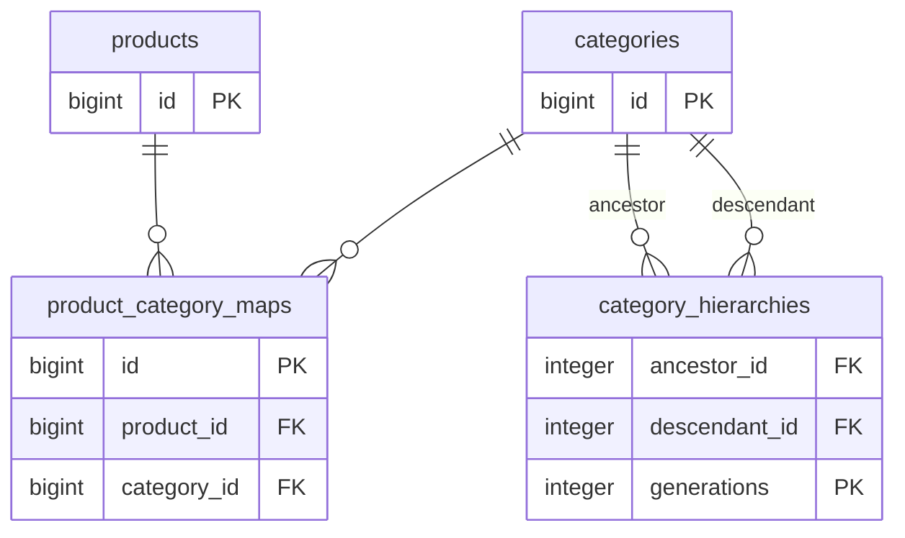
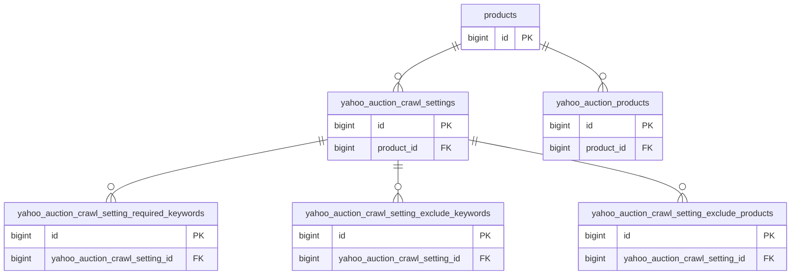
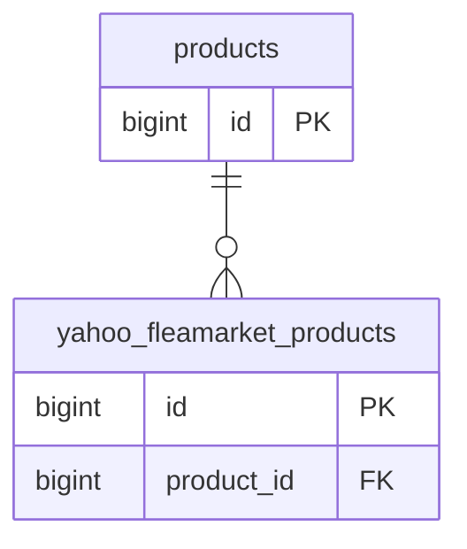
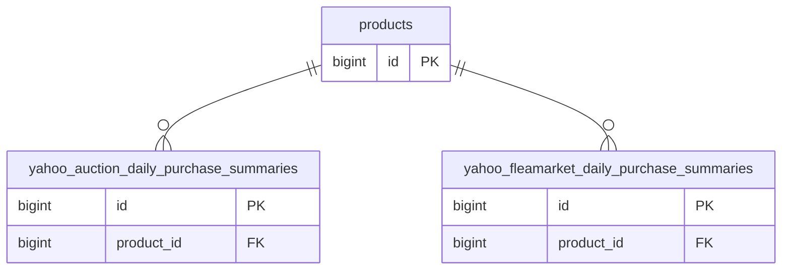
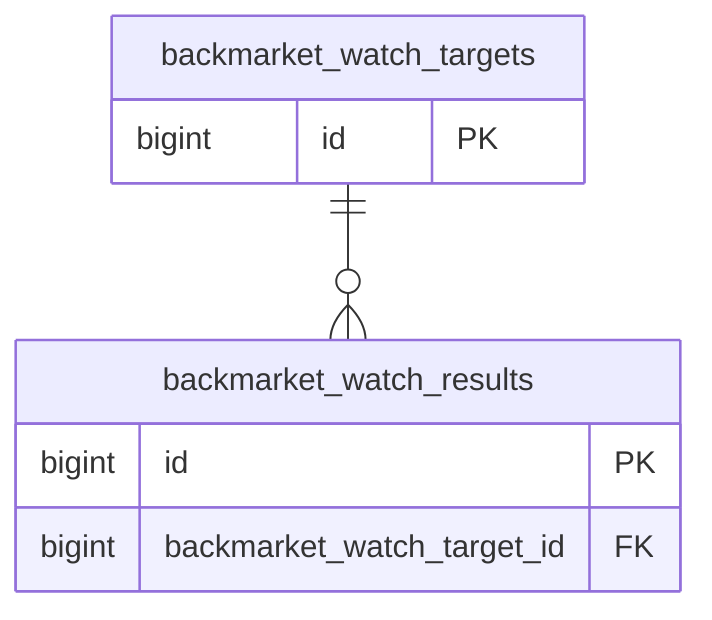

# アソシエーション

機能文書がまだ無い領域について、BFF / batch のテーブル間関連を確認する開発者向けのリファレンス。Provider の DB は対象外。機能文書がある領域のテーブル間関連は、その機能の DB 文書を正本とする。
領域の分け方は [Database](index.md)、カラム・インデックスは [ER](er.md)、商品モニタリングのテーブル定義は [商品モニタリングの DB](../features/product-monitoring/database.md)、現在の定義は [schema.rb](../../volumes/backend/db/schema.rb) を参照する。

## 計測対象管理

### カテゴリ

## クロール処理

### ヤフオク

### ヤフーフリマ

## 日次相場の集計

## Backmarket監視

