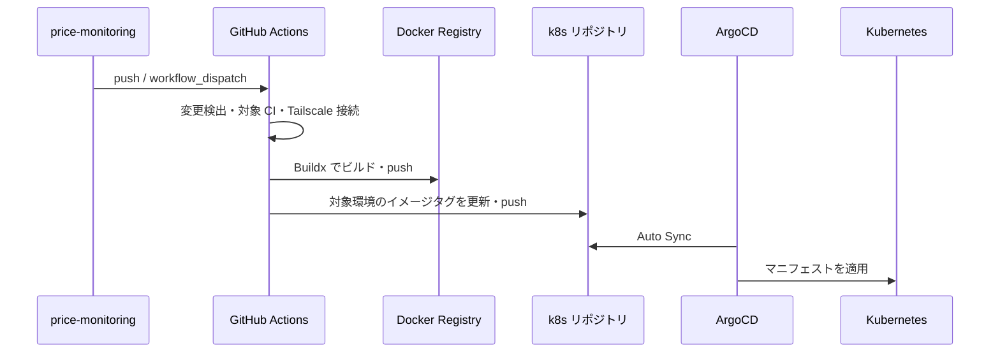

# CI/CD のパイプライン

開発・運用担当者向けに、このリポジトリの GitHub Actions の実行条件とデプロイ経路をまとめる。
実行条件の正本はリンク先の workflow。ローカル操作は [ローカル開発](../README.md) を参照する。

## 環境と実行契機

| 環境 | CI/CD workflow | 自動実行 | 全イメージの手動デプロイ |
| --- | --- | --- | --- |
| Integration | [cicd-integration.yml](../../../.github/workflows/cicd-integration.yml) | `develop` への push | [deploy-integration.yml](../../../.github/workflows/deploy-integration.yml) |
| Production | [cicd-production.yml](../../../.github/workflows/cicd-production.yml) | `master` への push | [deploy-production.yml](../../../.github/workflows/deploy-production.yml) |

CI/CD は `workflow_dispatch` による手動実行にも対応する。全イメージの手動デプロイは `workflow_dispatch` のみ。

## Pull Request の自動テスト

[ci-pr.yml](../../../.github/workflows/ci-pr.yml) は、Pull Request の作成・更新・再オープン時に、変更されたアプリのテストを実行する。送信先ブランチや作成者による制限はなく、Dependabot が作成した Pull Request も対象となる。

| 変更対象 | 実行するテスト |
| --- | --- |
| `volumes/backend/**` / `containers/backend/**` | `backend` コンテナで RuboCop を実行し、テスト DB を準備して RSpec を実行 |
| `volumes/auth-provider/**` / `containers/auth-provider/**` | `auth-provider` コンテナで RuboCop を実行し、テスト DB と Tailwind アセットを準備して RSpec を実行 |
| `volumes/frontend/**` / `containers/frontend/**` | `frontend` コンテナで `npm ci` 後、lint・型検査・Vitest を実行 |
| `docker-compose.yml` / `.github/workflows/ci-pr.yml` / `.github/workflows/cicd-integration.yml` / `.github/workflows/cicd-production.yml` | 上記すべての検証を実行 |

Frontend CI は `--no-deps` で実行し、バックエンド・DB・認証アプリの起動を必要としない。Playwright・Camoufox の独立したテストジョブは定義していない。同じ Pull Request に更新が入った場合は、実行中のテストをキャンセルして最新の変更を検証する。

バックエンドと認証アプリ の RuboCop と RSpec はそれぞれ別のジョブで並列実行する。RuboCop のジョブは依存サービスを起動しない。

この workflow はリポジトリのシークレットを必要とせず、デプロイ処理を含まない。マージ後は「環境と実行契機」の push による CI/CD が実行される。

## 変更検出と CI/CD

| 対象 | 変更検出するパス | CI | CD |
| --- | --- | --- | --- |
| バックエンド | `volumes/backend/**` / `containers/backend/**` | `backend` コンテナで RuboCop・DB 作成・migration・RSpec | CI 成功後、spec 以外のアプリファイルまたはコンテナ定義の変更時 |
| 認証アプリ | `volumes/auth-provider/**` / `containers/auth-provider/**` | `auth-provider` コンテナで RuboCop・テスト DB・Tailwind アセット準備・RSpec | CI 成功後、spec 以外のアプリファイルまたはコンテナ定義の変更時 |
| Frontend | `volumes/frontend/**` / `containers/frontend/**` | `frontend` コンテナで `npm ci`・lint・型検査・Vitest | CI 成功後、変更検出時 |
| Playwright | `containers/backend_playwright/**` | 独立した CI ジョブなし | 変更検出時 |
| Camoufox | `containers/backend_camoufox/**` | 独立した CI ジョブなし | 変更検出時 |

CI/CD の手動実行では変更の有無にかかわらず各ジョブを実行する。バックエンドと認証アプリ の CD はそれぞれ RuboCop と RSpec の両ジョブの成功が前提。Frontend の CD は Frontend CI の成功が前提。
Frontend CI は `docker-compose.yml` と各環境自身の CI/CD workflow の変更時にも実行する。これらだけの変更では Frontend CD は実行しない。
spec 以外の判定など正確な glob は workflow の `check_changes` を参照する。

CD の共通処理は [reusable-cd.yml](../../../.github/workflows/reusable-cd.yml) に定義している。

1. GitHub Actions runner を Tailscale に接続し、レジストリまでの経路（直接接続か DERP 中継か）を `tailscale ping` でジョブログに残す。public リポジトリのため、宛先の IP:ポートは伏せる。経路確認が失敗してもデプロイは続ける。
2. runner の make / Docker Buildx で対象イメージをビルドする。`cache=true` / `push=true` により GitHub Actions キャッシュを利用し、レジストリへ直接 push する。
3. [k8s リポジトリ](https://github.com/kuroweb/k8s) の `manifests/price-monitoring` で対象環境のイメージタグを更新し、commit / push する。競合時は最新の `master` を取り直し、更新から最大 5 回試行する。
4. ArgoCD がマニフェストを同期し、クラスタへ適用する。

## 全イメージの手動デプロイ

各環境の `deploy-*.yml` は CI の実行を含まない。デプロイ対象の検証を済ませてから実行する。
GitHub Actions runner を Tailscale に接続し、runner 上の make / Docker Buildx で バックエンド、Playwright、Camoufox、Frontend、認証アプリ の全イメージをビルドする。
この経路は再利用 CD と異なり、ビルド後に個別の push タスクを実行する。その後、対象環境の全イメージタグをまとめて更新し、k8s リポジトリへ commit / push する。

ビルド・push タスクは [Makefile](../../../Makefile) を参照する。認証アプリのイメージ名は `auth-provider-backend-<environment>`、マニフェスト更新時の `IMAGE` は `auth-provider-backend`。
Kubernetes の全体構成は [ルート README](../../../README.md#production)、認証固有の移行情報は [認証基盤の CI/CD と Kubernetes](../auth-provider/kubernetes.md) を参照する。
