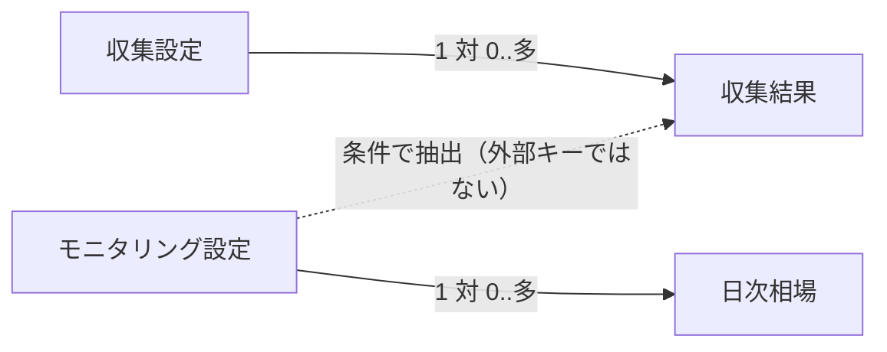

# 商品モニタリングの DB

この機能が持つテーブルと、振る舞いに効く列の意味を書く。カラムとインデックスの定義は [ER](../../database/er.md)、テーブル間の外部キーは [アソシエーション](../../database/association.md#商品モニタリング) を正本とする。取得の手順とジョブは [内部仕様](internal-spec.md)、画面から見える規則は [外部仕様](external-spec.md) を参照する。

## テーブル

| データ | テーブル | 役割 |
| --- | --- | --- |
| 収集設定 | `product_monitoring_crawl_settings` | 検索元と取得結果に適用する条件を持つ |
| 収集結果 | `product_monitoring_crawl_results` | 収集設定ごとの出品、価格、販売状態、除外状態を持つ |
| モニタリング設定 | `product_monitoring_monitors` | 複数の収集設定にまたがる表示・集計・通知の条件を持つ |
| 日次相場 | `product_monitoring_daily_market_prices` | モニタリング設定ごとの日次集計を持つ |

収集設定、収集結果、モニタリング設定、日次相場のつながり。点線は外部キーではない。

収集結果は一つの収集設定に属し、日次相場は一つのモニタリング設定に属する。モニタリング設定と収集設定の間に外部キーはなく、全設定の収集結果を条件で選ぶ。収集結果は URL には属さない。同じ収集設定の複数 URL で見つかった出品は1行にし、別の収集設定で見つかれば設定ごとに行ができる。

## 収集結果の列

定義の一覧は [収集結果の ER](../../database/er.md#product_monitoring_crawl_results) に置く。ここでは振る舞いに効く列だけを書く。

### 販売状態

`sold` は、集めた時点の販売状態である。`true` は売り切れ、`false` は販売中、空は不明。販売状態を取得できないサイトは空にする。画面の販売中は `sold` が `true` でないもの（不明を含む）。売り切れは `sold` が `true` のもの。トレファクは一覧から販売状態を判定できないため、常に販売中として保存する。売れた出品が最安値の候補に残り続ける。未対応。

### 売れた日

`sold_at` は売れた日である。取得できない出品や、売れた日を取らないサイトでは空である。日次相場は、この日が集計期間に入る収集結果を対象にする。

### 新着順の時刻

`recency_at` はカードの並びである。販売中と販売状態が不明な行は初めて保存した時刻で、再保存では進めない。売れた日がある売り切れはその売れた日、売れた日がない売り切れは空にする。一覧の新着順はこの空の行を含めない。詳細の新着順は `recency_at` の降順、空は末尾、同じ位置は id の降順である。インデックスの定義は [収集結果の ER](../../database/er.md#product_monitoring_crawl_results) に置く。

### 除外

`excluded_at` は除外した日時である。空は除外していない。除外した行は、通常の結果表示、通知、集計から外れる。

### 出品の同一性

`platform` と `external_id` の組で、サイト上の同じ出品を表す。最安値、収集結果の表示、新着通知はこの組で重複をまとめる。日次相場の集計は `external_id` だけでまとめる。判定は揃っていない。未対応。
