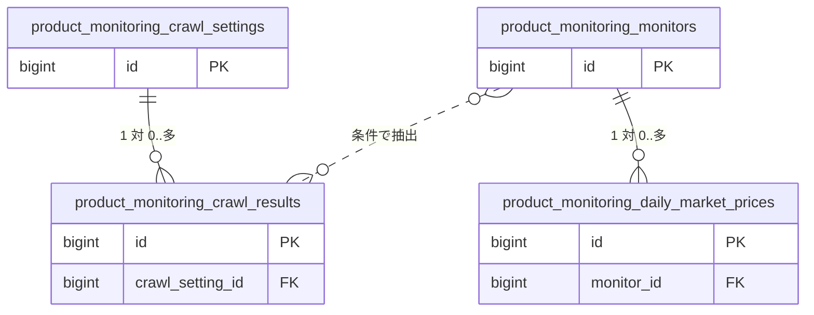

# 商品モニタリングの DB

この機能が持つテーブル、振る舞いに効く列の意味、テーブル間の関連を書き、関連の正本はこの文書とし、カラムとインデックスの定義は [ER](../../database/er.md) を正本とし、取得の手順とジョブは [内部仕様](internal-spec.md)、画面から見える規則は [外部仕様](external-spec.md) を参照する。

## テーブル

| データ | テーブル | 役割 |
| --- | --- | --- |
| 収集設定 | `product_monitoring_crawl_settings` | 検索元と取得結果に適用する条件を持つ |
| 収集結果 | `product_monitoring_crawl_results` | 収集設定ごとの出品、価格、販売状態、除外状態を持つ |
| モニタリング設定 | `product_monitoring_monitors` | 複数の収集設定にまたがる表示・集計・通知の条件を持つ |
| 日次相場 | `product_monitoring_daily_market_prices` | モニタリング設定ごとの日次集計を持つ |

| から | へ | 対応 | 外部キー | 意味 |
| --- | --- | --- | --- | --- |
| 収集設定 | 収集結果 | 1 対 0..多 | あり | 収集結果は一つの収集設定に属する |
| モニタリング設定 | 日次相場 | 1 対 0..多 | あり | 日次相場は一つのモニタリング設定に属する |
| モニタリング設定 | 収集結果 | 条件で抽出 | なし | 収集設定に外部キーを持たず、全収集設定の収集結果を条件でフィルターする |

| 対象 | 内容 |
| --- | --- |
| URL | 収集結果は属さない |
| 同じ収集設定の複数 URL | 見つかった出品は1行 |
| 別の収集設定 | 設定ごとに行ができる |

既存の計測対象管理とは独立したテーブル群である。

## 収集結果の列

| 列名 | テーブル | 取る値 | 空のとき | どこで使うか |
| --- | --- | --- | --- | --- |
| `sold` | `product_monitoring_crawl_results` | 集めた時点の販売状態。`true` は売り切れ、`false` は販売中 | 不明。販売状態を取得できないサイトは空 | 画面の販売中は `sold` が `true` でないもの（不明を含む）。売り切れは `sold` が `true` のもの |
| `sold_at` | `product_monitoring_crawl_results` | 売れた日 | 取得できない出品や、売れた日を取らないサイト | 日次相場は、この日が集計期間に入る収集結果を対象にする |
| `recency_at` | `product_monitoring_crawl_results` | [新着順の時刻](#新着順の時刻) | [新着順の時刻](#新着順の時刻) | カードの並び |
| `excluded_at` | `product_monitoring_crawl_results` | 除外した日時 | 除外していない | 除外した行は、通常の結果表示、通知、集計から外れる |
| `platform` と `external_id` | `product_monitoring_crawl_results` | 組でサイト上の同じ出品を表す | — | 最安値、収集結果の表示、新着通知。日次相場は[出品の同一性](#出品の同一性) |

### 新着順の時刻

| 行の状態 | 入れる値 |
| --- | --- |
| 販売中と不明 | 初めて保存した時刻。再保存では進めない |
| 売れた日がある売り切れ | その売れた日 |
| 売れた日がない売り切れ | 空 |

一覧の新着順はこの空の行を含めず、詳細の新着順は `recency_at` の降順、空は末尾、同じ位置は id の降順である。

### 出品の同一性

| 用途 | まとめるキー |
| --- | --- |
| 最安値・表示・新着通知 | `platform` と `external_id` |
| 日次相場 | `external_id` だけ |

注: 判定は揃っていない。未対応。トレファクは一覧から販売状態を判定できないため、常に販売中として保存する。売れた出品が最安値の候補に残り続ける。未対応。
