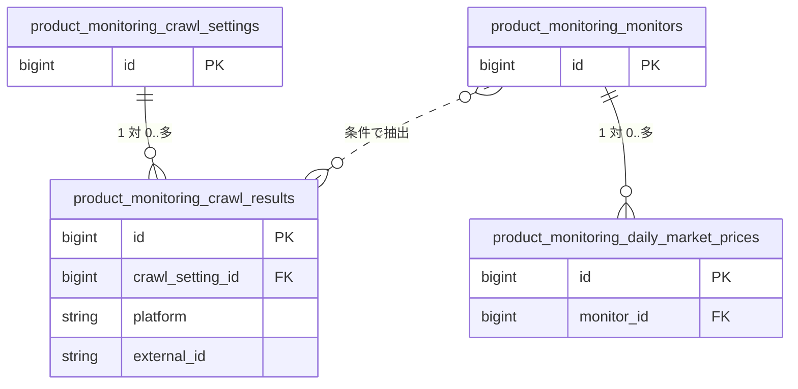

# 商品モニタリングの DB

画面から見える規則は [外部仕様](external-spec.md)、保存の仕方は [内部仕様](internal-spec.md) を参照する。

## アソシエーション

### 関係

| から | へ | 対応 | 外部キー | 意味 |
| --- | --- | --- | --- | --- |
| 収集設定 | 収集結果 | 1 対 0..多 | あり | 収集結果は一つの収集設定に属する |
| モニタリング設定 | 日次相場 | 1 対 0..多 | あり | 日次相場は一つのモニタリング設定に属する |
| モニタリング設定 | 収集結果 | 条件で抽出 | なし | 収集設定に外部キーを持たず、全収集設定の収集結果を条件でフィルターする |
| 収集結果 | URL | 属さない | なし | 収集結果は URL に属さない |
| 同じ収集設定の複数 URL | 収集結果 | 1行 | なし | 見つかった出品は1行 |
| 別の収集設定 | 収集結果 | 行が分かれる | なし | 設定ごとに行ができる |
| 商品モニタリング | 計測対象管理 | 関連がない | なし | 既存の計測対象管理とは独立したテーブル群である |

### 図

## スキーマ

### テーブル

| データ | テーブル | 役割 |
| --- | --- | --- |
| 収集設定 | `product_monitoring_crawl_settings` | 検索元と取得結果に適用する条件を持つ |
| 収集結果 | `product_monitoring_crawl_results` | 収集設定ごとの出品、価格、販売状態、除外状態を持つ |
| モニタリング設定 | `product_monitoring_monitors` | 複数の収集設定にまたがる表示・集計・通知の条件を持つ |
| 日次相場 | `product_monitoring_daily_market_prices` | モニタリング設定ごとの日次集計を持つ |

### product_monitoring_crawl_settings

#### カラム

| カラム | 型 | NULL | 備考 |
| --- | --- | --- | --- |
| id | bigint | NOT NULL | PK |
| name | string | NOT NULL |  |
| enabled | boolean | NOT NULL | default false |
| search_keyword | string |  |  |
| platforms | json | NOT NULL | default `[]` |
| search_urls | json | NOT NULL | default `[]` |
| required_keywords | json | NOT NULL | default `[]` |
| negative_keywords | json | NOT NULL | default `[]` |
| min_price | integer |  |  |
| max_price | integer |  |  |
| created_at | datetime | NOT NULL |  |
| updated_at | datetime | NOT NULL |  |

#### インデックス

なし

### product_monitoring_crawl_results

#### カラム

| カラム | 型 | NULL | 備考 |
| --- | --- | --- | --- |
| id | bigint | NOT NULL | PK |
| crawl_setting_id | bigint | NOT NULL | FK |
| platform | string | NOT NULL |  |
| external_id | string | NOT NULL |  |
| name | string | NOT NULL |  |
| product_url | text | NOT NULL |  |
| thumbnail_url | text |  |  |
| price | integer | NOT NULL | default 0 |
| buyout_price | integer |  |  |
| sold | boolean |  | NULL を許す |
| sold_at | datetime |  |  |
| recency_at | datetime |  | NULL を許す |
| ends_at | datetime |  |  |
| excluded_at | datetime |  | NULL を許す |
| created_at | datetime | NOT NULL |  |
| updated_at | datetime | NOT NULL |  |

#### インデックス

| 名前 | カラム | 備考 |
| --- | --- | --- |
| index_product_monitoring_crawl_results_on_created_at | created_at |  |
| index_product_monitoring_crawl_results_on_recency_at | recency_at |  |
| index_product_monitoring_crawl_results_on_recency_at_and_id | recency_at, id | 降順 |
| index_product_monitoring_crawl_results_on_external_id | external_id |  |
| idx_monitoring_crawl_results_lowest_price | sold, excluded_at, price, id |  |
| idx_on_crawl_setting_id_external_id_a6fd3476b8 | crawl_setting_id, external_id | unique |
| index_product_monitoring_crawl_results_on_crawl_setting_id | crawl_setting_id |  |

### product_monitoring_monitors

#### カラム

| カラム | 型 | NULL | 備考 |
| --- | --- | --- | --- |
| id | bigint | NOT NULL | PK |
| name | string | NOT NULL |  |
| enabled | boolean | NOT NULL | default `false` |
| discord_enabled | boolean | NOT NULL | default `false` |
| required_keywords | json | NOT NULL | default `[]` |
| negative_keywords | json | NOT NULL | default `[]` |
| min_price | integer |  |  |
| max_price | integer |  |  |
| last_lowest_signature | string |  |  |
| created_at | datetime | NOT NULL |  |
| updated_at | datetime | NOT NULL |  |
| newest_notification_enabled | boolean | NOT NULL | default `false` |
| newest_notified_until | datetime |  |  |

#### インデックス

なし

### product_monitoring_daily_market_prices

#### カラム

| カラム | 型 | NULL | 備考 |
| --- | --- | --- | --- |
| id | bigint | NOT NULL | PK |
| date | date | NOT NULL |  |
| average_transaction_price | integer |  | NULL を許す |
| transaction_count | integer | NOT NULL | default 0 |
| created_at | datetime | NOT NULL |  |
| updated_at | datetime | NOT NULL |  |
| monitor_id | bigint | NOT NULL | FK |

#### インデックス

| 名前 | カラム | 備考 |
| --- | --- | --- |
| idx_on_monitor_id_date_df939332ac | monitor_id, date | unique |
| index_product_monitoring_daily_market_prices_on_monitor_id | monitor_id |  |
