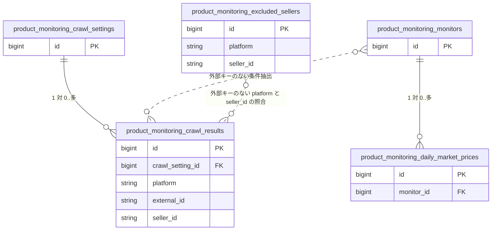

# 商品モニタリングの DB

商品モニタリングのテーブル間の関連を確認する開発者向けに、ER 図で示す。カラム・インデックス・外部キーは [テーブル定義](../../development/database/tables.md)、画面から見える規則は [外部仕様](external-spec.md)、保存の仕方は [内部仕様](internal-spec.md) を参照する。

## アソシエーション

