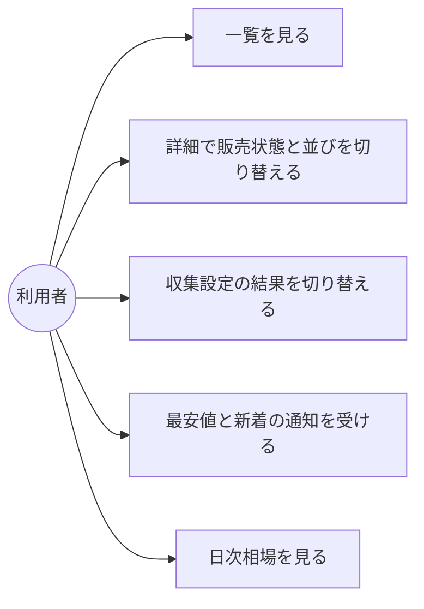
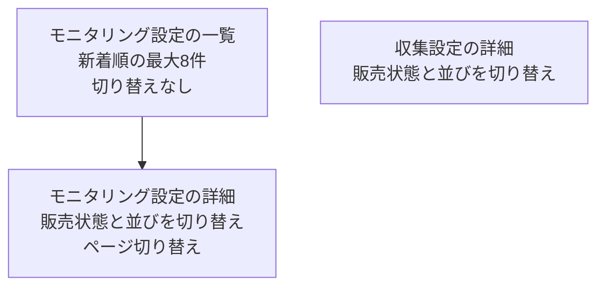
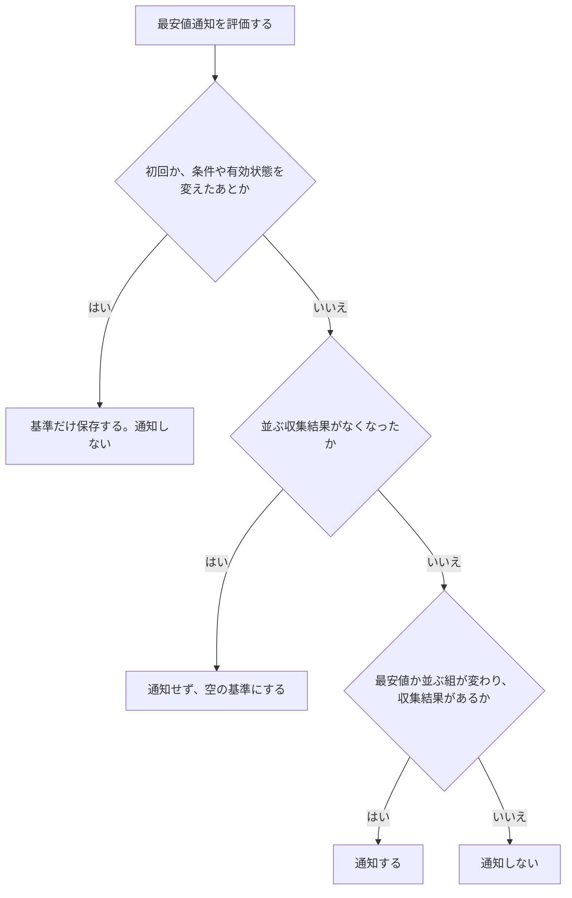

# 商品モニタリングの外部仕様

外部仕様。画面と通知から見える振る舞いを書く。操作の手順は[オペレーション](operations.md)を参照する。パス、JSON、ステータスコード、クラス名、ジョブ名は書かない。

収集設定でサイトから集めた収集結果を、モニタリング設定の抽出条件で選んで表示する。在庫は集めた時点のもので、リアルタイムではない。取得結果に現れなくなった出品も保存されるため、表示に古い情報が含まれることがある。

## 使い方

利用者から見たユースケース。今の画面と通知にあるものに限る。

| 誰が | 何をしたいか | どこで | 結果 |
| --- | --- | --- | --- |
| 利用者 | 一覧を見る | モニタリング設定の一覧 | 各行は抽出条件に合う収集結果を新着順に最大8件出す。売り切れを含む。売れた日が無い売り切れは出ない。販売状態の切り替えも並び替えも無い。販売中の最安値と、直近の平均取引価格も出る |
| 利用者 | 詳細で販売状態と並びを切り替える | モニタリング設定の詳細 | 抽出条件に合う保存済みを1ページ12件出す。ページを切り替えると表示が入れ替わる。販売状態か並びを変えると1ページ目に戻る。売れた日が無い売り切れは、売り切れとすべてに残る |
| 利用者 | 収集設定の結果を切り替える | 収集設定の詳細 | その収集設定の保存済みを、「すべて」「販売中」「売り切れ」と、「新着順」「価格の安い順」「価格の高い順」で切り替える |
| 利用者 | 最安値と新着の通知を受ける | 通知 | 有効なモニタリング設定を10分ごとに評価し、条件を満たすと通知する。それぞれ最大5件 |
| 利用者 | 日次相場を見る | モニタリング設定の詳細 | 日ごとの平均取引価格と取引件数を出す。取引がない日は平均がなく、件数は0 |

画面の関係。モニタリング設定の一覧から詳細へ進む。

一覧は8件の新着だけで、販売状態の切り替えも並び替えも無い。詳細は販売状態と並びを切り替え、ページを切り替えて表示を入れ替える。収集設定の詳細も、同じ販売状態と並びの切り替えを持つ。

## モニタリング設定の一覧

各行は、抽出条件に合う収集結果を新着順に最大8件出す。売り切れを含む。売れた日が無い売り切れは出ない。販売状態の切り替えも並び替えも無い。あわせて、販売中の最安値と、直近の平均取引価格を出す。

## モニタリング設定の詳細

抽出条件に合う保存済みの収集結果を、一度に全件は描かず、1ページ12件ずつ出す。最初は1ページ目を出す。「前へ」「次へ」やページ番号を押すと、同じ条件の選んだページに表示を入れ替える。最終ページでは「次へ」は出さない。販売状態または並びを変えると、先頭のページから出し直す。除外した収集結果は出ない。同じ出品は1件にまとめる。

販売状態は「すべて」「販売中」「売り切れ」。販売中は売り切れでないもの（販売状態が不明なものを含む）。売り切れは売り切れのもの。売れた日が無い売り切れは、売り切れとすべてに残り、ページの件数で落とさない。並びは「新着順」「価格の安い順」「価格の高い順」。新着順では、売れた日が無い売り切れを末尾に置く。価格が同じときは、id の大きい行を先にする。

除外は行を残したまま、表示・通知・集計から外す。同じ収集設定で再取得しても除外は残る。削除は選んだ行だけを消す。別の収集設定に同じ出品があれば残り、次の取得で再び保存されることがある。モニタリング設定からの除外は、表示している行に適用する。同じ出品が別の収集設定にあれば、その行は除外されず再び表示されることがある。取り消しは元の収集設定の更新から行う。保存済みの日次相場はすぐには変わらず、次の集計で反映する。

## 収集設定の詳細

その収集設定の保存済みの収集結果を対象に、「すべて」「販売中」「売り切れ」と、「新着順」「価格の安い順」「価格の高い順」で切り替える。

## 通知

最安値通知と新着通知を、評価のタイミングと届く条件で分けたもの。

| 通知 | いつ評価するか | 通知するとき | 通知しないとき | 届く件数 |
| --- | --- | --- | --- | --- |
| 最安値通知 | 最安値の通知評価が有効なモニタリング設定を10分ごと | 初回のあと、最安値、または最安値に並ぶ収集結果の組が変わり、収集結果があるとき。並ぶ収集結果がなくなったあと、再び現れたとき | 初回。並ぶ収集結果がなくなったとき。条件や有効状態を変えたあとの次の評価。送信先が未設定または形式が不正なとき。有効な送信先への送信が失敗したとき | 最大5件。本文は最大2000文字 |
| 新着通知 | 新着の通知評価が有効なモニタリング設定を、最安値通知と同じタイミング | 前回評価した範囲の終わりより後から、評価時刻の5分前までに保存された、条件に一致する除外されていない販売中の収集結果があるとき | 初回。条件や新着通知の有効状態を変えたあと。同じ出品が範囲より前に保存されているとき。送信先が未設定または形式が不正なとき。有効な送信先への送信が失敗したとき | 新しい順に最大5件と、件数 |

最安値通知で並ぶ収集結果がなくなったときは、通知せず空の基準に更新する。送信先が未設定または形式が不正なときは通知せず、評価時点の結果を基準に保存する。最後の評価のあとに起きた変化は、送信先を設定したあとに通知される場合がある。有効な送信先への送信が失敗したときは基準を更新せず、次回再試行する。送信結果が確認できなかった場合などは、再試行で通知が重複することがある。

新着通知の初回と、条件や新着通知の有効状態を変えたあとは、範囲の終わりだけを保存して通知しない。送信先が未設定または形式が不正なときは通知せず範囲を進める。有効な送信先への送信が失敗したときは範囲を進めず、次回まとめて再試行する。通知は最大で約15分遅れる。新着は、サイトに掲載された日時ではなく、収集結果として初めて保存された日時で判定する。新しい収集設定を追加するか、収集設定の検索や保存条件を広げると、その収集で初めて保存された収集結果は、サイト上では古くても新着として通知される。一度削除された収集結果が再び保存された場合も新着になる。いずれも未対応。

最安値通知で、通知するか基準だけを残すかの分岐。

空の基準のあと再び収集結果が現れたときは、最安値か並ぶ組が変わって収集結果があるので通知する。

## 日次相場

取引がない日は平均取引価格がなく、取引件数は0。期間の平均取引価格は、日ごとの平均を取引件数で重み付けする。集計は画面からの手動実行に加え、毎日0時に直近30日分を行う。抽出条件を変えると、それまでの日次相場は消え、次の集計で作り直される。

## 上限

| 対象 | 上限 |
| --- | --- |
| モニタリング設定の一覧の収集結果 | 最大8件。売れた日が無い売り切れは含まない |
| モニタリング設定の詳細の収集結果 | 1ページ12件。選んだページだけ表示する |
| 検索結果URL | 最大5件 |
| 1件のURL | 最大5ページ、1ページ100件 |
| 取得 | 1 URL あたり60秒、1回の取得は30分 |
| 最安値通知と新着通知に載せる収集結果 | 最大5件 |
| 通知本文 | 最大2000文字 |
| 新着通知の遅れ | 取得から最大で約15分 |
| 日次相場の手動集計 | 直近30日 |
| 取引の取得期間 | 開始日から終了日までの日数が90未満 |

通知本文が送信先の都合で届かないことと、画面の収集結果がサイトの今の在庫と違うことはある。
