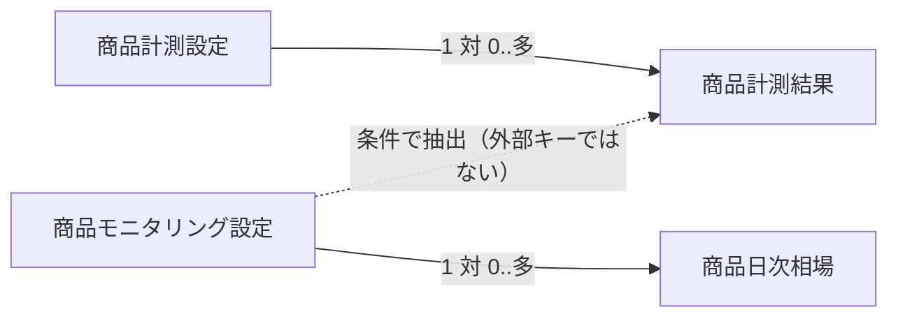
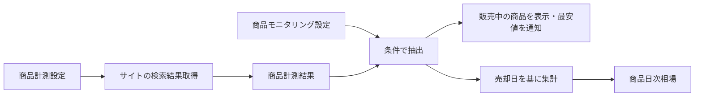
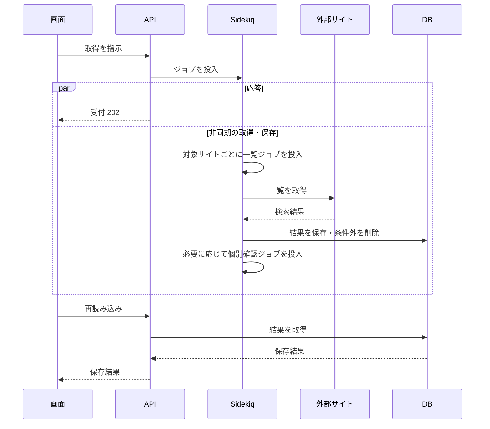

# 商品計測と商品相場

商品計測・商品モニタリングを開発・運用する人向けに、処理の仕様、取得方式と API を説明する。操作は[商品計測・商品モニタリングの操作](operations.md)を参照する。

商品計測設定に検索語とサイト、または検索結果URLと共通の条件を登録し、取得した商品計測結果を商品モニタリング設定で絞り込み、日ごとに集計する。

## 文書の見方

このページは、機能全体のデータと処理の関係、振る舞い、外部サイトへの取得方式、API を扱う。画面の操作手順は[操作](operations.md)、カラム・インデックスは[ER](../../database/er.md)、テーブル間の外部キーは[アソシエーション](../../database/association.md)を参照する。実際の動作とスキーマの確認には実装と `volumes/backend/db/schema.rb` を使う。

## データの関係

| データ | テーブル | 役割 |
| --- | --- | --- |
| 商品計測設定 | `product_crawl_settings` | 検索元と取得結果に適用する条件を持つ |
| 商品計測結果 | `product_crawl_results` | 計測設定ごとの出品、価格、販売状態、除外状態を持つ |
| 商品モニタリング設定 | `product_watch_settings` | 複数の計測設定にまたがる表示・集計・通知の条件を持つ |
| 商品日次相場 | `product_aggregation_results` | モニタリング設定ごとの日次集計を持つ |

商品計測結果は一つの商品計測設定に属し、商品日次相場は一つの商品モニタリング設定に属する。商品モニタリング設定と商品計測設定の間に外部キーはなく、全設定の計測結果を条件で選ぶ。各テーブルの関連の正本は[アソシエーション](../../database/association.md)に置く。

## 処理の全体像

計測設定を基に外部サイトから取得し、結果を保存する。モニタリング設定は保存済みの結果を対象に表示・通知・集計する。取得、通知評価、相場集計はそれぞれ別のタイミングで動くため、保存結果や日次相場が常に最新の外部サイトの状態を表すわけではない。実行間隔と判定条件は[処理と制約](#処理と制約)を参照する。

### 取得して保存する流れ

手動操作では API がジョブを投入した後に `202` を返し、取得と保存は非同期に行う。取得と保存はサイトごとの一覧ジョブが行い、個別確認もサイトごとのジョブで行う。図は処理の関係を示しており、`202` の応答とジョブの開始の前後は保証されず、再読み込み時にジョブが完了しているとも限らない。取得後は条件に合う結果を保存し、必要な出品について個別確認ジョブを投入する。定期取得も同じ保存処理を使う。個別確認の対象や取得の失敗時の扱いは[処理と制約](#処理と制約)に記す。

## 設計方針

- 既存の計測対象管理とは独立した新規のテーブル群とし、既存テーブルを参照しない。旧テーブルの扱いはこの機能の仕様には含めない。
- カテゴリは持たない。カテゴリなどの絞り込みは検索結果URLで指定する。
- 将来の賃貸ページのクロールと区別するため、テーブル名は `product_`、ドメイン名は「商品」で始める。
- 必須語・除外語・価格帯は商品計測設定の全URLで共有する。サイトごとに条件を変える構成は、旧スキーマで使われなかったため採らない。
- 商品計測結果は商品計測設定に属し、URLには属さない。同じ設定の複数URLで見つかった出品は1行にし、別の設定で見つかれば設定ごとに行ができる。
- 商品モニタリング設定は商品計測設定に紐付けず、全商品計測設定の商品計測結果を条件で絞り込む。
- 商品計測と商品モニタリングは互いのコードを参照しない。絞り込み条件（価格帯・必須語・除外語）の判定は設定ごとの Matcher（`CrawlSettings::Matcher` と `WatchSettings::Matcher`）が、入力の検証は設定ごとの Writer が持ち、2機能で共有しない。モデルには判定を置かない。
- 商品モニタリングは商品計測結果を読むだけで、書き込まない。読む項目は、販売状態（`sold`）、売れた日（`bought_date`）、除外日時（`excluded_at`）、価格・名前などの表示項目と、出品の同一性（`platform` と `external_id`）である。商品計測側でこれらの意味を変えるときは、商品モニタリングへの影響を確認する。
- 出品の同一性の判定は揃っていない。最安値と販売中商品の表示は `platform` と `external_id` の組、相場集計は `external_id` だけで重複をまとめる。トレファクは販売状態を一覧から判定できないため常に販売中として保存し、売れた出品が最安値の候補に残り続ける。いずれも未対応。

## 処理と制約

### 検索と通知

- 最安検索は価格順に小分けで読み、最安価格を超えた時点で終了する。バッチ間の一貫性は MySQL の `REPEATABLE READ` 分離レベルに依存する。
- 画面の検索も価格順に小分けで読み、条件に一致する重複のない商品が8件に達すると終了する。8件に満たない場合は価格帯内の販売中候補を全件走査するため、候補数や設定数が増えると表示に時間がかかる。バッチ間の一貫性は MySQL の `REPEATABLE READ` 分離レベルに依存する。
- 定期評価は設定ごとのジョブに分割する。相場集計と同じ Sidekiq プロセスを使うため、個別の通知処理中は相場集計も待つ場合がある。
- 同じ設定の重複通知と条件変更との競合を防ぐため、Discordへの送信中も設定の行ロックを保持する。送信先の応答が遅いと、その設定の編集・削除は送信完了まで待つ。
- 商品モニタリングは、全商品計測設定の保存済み結果から除外されていない販売中（`sold = false`）の商品を条件で絞り込み、価格の安い順に最大8件表示する。取得結果に現れなくなった出品も保存されるため、表示商品に古い出品が含まれることがあり、リアルタイムの在庫を保証しない。
- 有効な商品モニタリング設定を10分ごとに評価する。初回評価で基準を保存し、その後、最安価格または同額の最安商品集合が変化して商品がある場合に通知する。最安商品がなくなった場合は通知せず空の基準に更新し、再び現れた場合は通知する。条件・有効状態の変更後は基準をリセットし、次の評価を初回として扱う。送信先が未設定または形式不正の場合は通知せず、評価時点の結果を基準に保存する。最後の評価後に生じた変化は、送信先の設定後に通知される場合がある。有効な送信先への送信が失敗した場合は基準を更新せず次回再試行する。通知に含める商品は最大5件、本文は最大2000文字。送信結果が確認できなかった場合などは、再試行により通知が重複することがある。

### 取得と集計

- 取得は画面からの手動実行に加え、有効な商品計測設定を10分ごとにSidekiqで実行する。集計は画面からの手動実行に加え、全商品モニタリング設定について毎日0時に直近30日分をSidekiqで実行する。
- 旧相場設定は参照せず、既存の商品計測結果から集計する。モニタリングの絞り込み条件を変更すると、それまでの日次相場は削除され、次の集計で更新される。
- 追加URLは最大5件。検索語からは選択サイトごとにURLを組み立て、ヤフオクは出品中と落札相場の2件を検索する。組み立てたURLに価格帯は含めず、画面にも表示しない。1 URLにつき最大5ページ・1ページ100件（最大500件）。次ページがない場合に終了する。結果が0件のページでも次ページがあれば続ける。途中の取得が失敗したURLは失敗とする。1 URLの取得は60秒を上限とする。取得はサイトごとのジョブで行い、ジョブ全体は30分を上限とする。手動取得は設定の有効・無効にかかわらず実行する。
- イオシスの機種グループ検索（`t=g`）は登録できない。`t=g` のない個別出品の検索URLを使う。単一の価格として解釈できない出品は保存しない。

### 絞り込み・除外・削除

- 必須語はAND、除外語はOR。カンマ・改行で複数指定する。出品名との部分一致で判定し、比べる前に両方をNFKCで正規化して小文字にし、空白を除く（`iPad Pro` は `ｉＰａｄＰｒｏ` に一致する）。商品計測設定と商品モニタリング設定で同じ判定にそろえる。判定は `CrawlSettings::Matcher` と `WatchSettings::Matcher` に別々にあるので、変えるときは両方を同時に直す。価格は上下限を含み、空欄は無制限。
- 出品の除外は商品計測結果の行ごとに `excluded_at` を設定し、通常の結果表示と集計から除く。同じ設定で再取得するときは `external_id` で除外を判定する。
- 出品の削除は選択した商品計測結果の行だけを消す。同じ出品が別の設定にあれば残り、再取得されると再登録される。保存済みの日次相場は変更せず、次回の集計で反映する。商品計測結果と商品モニタリングのカードから操作できる。
- 商品モニタリングからの除外も表示元の行に適用する。同じ出品が別の商品計測設定に保存されている場合、その行は除外されず、商品モニタリングに再表示されることがある。取り消しは元の商品計測設定の更新モーダルで行う。
- 取得して保存するとき、保存済みの結果のうち現在の条件に一致しないものを、除外済みの行も含めて削除する。今回の検索結果に出なかった出品は、条件に一致していれば残す。
- 商品計測設定の更新で必須語・除外語・価格帯のいずれかを変えたときも、同じ削除を更新と同じトランザクションで行う。名前・有効状態・検索語・サイト・検索結果URLだけの変更では削除しない。商品日次相場は再計算せず、次の集計で反映する。

### 相場集計と販売状態

- 商品相場は、除外されておらず条件に一致する商品計測結果のうち、`bought_date` が集計期間に入るものを `external_id` で1件にまとめ、日ごとに平均する。対象の取り出しは `ProductMonitoring::Watching::AggregationPurchases` にまとめ、集計と相場対象の商品のAPIで共有する。
- メルカリは一覧の売り切れ表示と個別ページの JSON-LD の在庫状態から販売状態を確認し、売れた日は相対表示から日単位で推定する。一覧から消えた販売中または販売状態不明の出品と、売り切れで売れた日が不明な出品は、最終更新から3時間経過すると個別確認の候補になる。一覧で初めて売り切れと確認した出品は、待たずに候補になる。個別ページの状態を判定できない場合や再試行を使い切った場合は、販売状態を変えず確認日時を更新する。イオシス・トレファクは一覧にある出品を販売中とし、じゃんぱらは一覧の売り切れ表示を反映する。これら3サイトでは売れた日は取得しない。サムネイルはイオシスの一覧の画像URL、メルカリは出品IDから組み立てたURLを保存する。
- じゃんぱらの一覧の売り切れ表示は、価格がなくても検索結果にある既存の出品の販売状態に反映する。売れた日と更新日時はこの反映では変更しない。
- イオシスとじゃんぱらは、そのサイトの検索元が1件以上ありすべての取得が成功し、ページ上限で打ち切られなかった場合、検索結果から消えて最終更新から3時間以上経った出品を売り切れにする。検索結果に戻った販売中の出品は販売中に戻す。価格がない出品も存在判定に含め、この判定では売れた日と更新日時を変更しない。
- Yahoo!フリマも一覧の sold 画像と個別ページの JSON-LD から販売状態を確認し、時計アイコンの更新日時を既存クローラーと同じ基準で日単位に換算する。日時が表示されない場合は不明のままとする。個別確認の候補と間隔はメルカリと同じ。個別確認は設定ごと・サイトごとに1回最大50件。画像URLは一覧から取得する。
- 取得元が失敗しても、売却日が不明な出品は個別確認する。一覧から消えた出品は、そのサイトの取得元がすべて成功した場合に確認する（ページ上限による打ち切りは個別確認を妨げない）。取得はサイトごとのジョブで行うため、別サイトの失敗は影響しない。
- ヤフオクは出品中の一覧を販売中、落札相場の一覧を売り切れとし、落札相場の終了日時を売れた日として保存する。即決価格と終了日時は一覧から取得し、個別確認は行わない。

## 取得方式と制限

入力URLをHTTPSの対応ホスト・検索パスに限定する。取得は全サイトとも本機能の Playwright クライアント（`Crawling::Client`）を使い、サーバーのIPから直接取得しないよう、プロキシ一覧から選んだプロキシ（`Crawling::Proxy`）を経由する。広告・計測などの通信は `Crawling::RequestBlocklist` で止める。従来の商品計測（`Crawl::*`）のクライアントは使わない。プロキシの一覧を取得できずプロキシが無いときは、接続せずに取得を失敗にする。イオシス・じゃんぱら・トレファクは JavaScript なしで一覧が描画されるので、スクリプトを遮断して取得し、遷移後の HTTPS ホストと描画後 HTML の10 MiB 上限を検証する。サイトに拒否されるプロキシがあるため、この3サイトは非2xxの応答なら接続し直して別のプロキシで最大5回試す。メルカリはJavaScriptを実行して描画し、ブラウザのリダイレクトやサブリソース通信を許可する。各ページの遷移後に最終URLがHTTPSの `jp.mercari.com` であることを確認し、描画後のHTMLが10 MiBを超えた場合は失敗とする。メルカリの応答にはストリーミングのサイズ上限を適用しない。いずれも取得したHTMLはNokogiriで解析する。

じゃんぱらは WAF が古い User-Agent を拒否するため、新しい User-Agent で取得する。一覧の SRCODE または ITMCODE の商品グループを1出品とし、価格はグループの下限価格を保存する。個別の店舗在庫は確認せず、一覧の売り切れ表示を反映する。

トレファクは一覧の `/item/<数字>` を出品IDとし、画像の代替テキストを出品名、税込の表示価格を価格として保存する。一覧には売り切れの出品も並ぶが価格が表示されないため取り込まず、販売中の出品だけを保存する。売れた日は一覧・個別ページのどちらにも表示されないので、個別確認は行わない。次ページは `page` を1つずつ増やして取得する。売り切れだけのページは空結果として扱い、次ページがあれば取得を続ける。

### コードとジョブの構成

商品計測は `ProductMonitoring::Crawling`、商品モニタリングは `ProductMonitoring::Watching` に置く。商品計測は、サイトごとに一覧用と個別確認用のクラスとジョブを持つ。

| サイト | 一覧（`<サイト>::Listing::`） | 個別確認（`<サイト>::Detail::`） |
| --- | --- | --- |
| メルカリ（`Mercari`） | `SearchUrl` / `Crawler` / `ListPage` / `Syncer` / `SyncJob` | `Crawler` / `Syncer` / `SyncJob` |
| Yahoo!フリマ（`YahooFleamarket`） | `SearchUrl` / `Crawler` / `Syncer` / `SyncJob` | `Crawler` / `Syncer` / `SyncJob` |
| ヤフオク（`YahooAuction`） | `SearchUrl` / `Crawler` / `ListPage` / `Syncer` / `SyncJob` | なし |
| イオシス（`Iosys`） | `SearchUrl` / `Crawler` / `Syncer` / `SyncJob` | なし |
| じゃんぱら（`Janpara`） | `SearchUrl` / `Crawler` / `ListPage` / `Syncer` / `SyncJob` | なし |
| トレファク（`TreasureFactory`） | `SearchUrl` / `Crawler` / `Syncer` / `SyncJob` | なし |

- `SearchUrl` は、ホスト・検索パス・サイト名と、検索語からの検索結果URLの組み立て、登録する検索結果URLの検証を持つ。
- 一覧の `Crawler` は、設定の検索結果URLのうちそのサイトの分を、ページを送りながら取得して出品を返す。失敗したURLはログに残して次のURLへ進み、全URLが失敗したらジョブを失敗にして再試行する。イオシス・じゃんぱら・メルカリ・Yahoo!フリマは、全URLを最後のページまで取得できたかも返す。メルカリ・ヤフオク・じゃんぱらは1ページの解析を `ListPage` に分ける。1ページの件数が上限（実際の件数より大きい値）を超えたときと、メルカリで全セルを描画しきれなかったときも、一覧を最後まで取得できなかったとする。
- 一覧の `Syncer` は、取得した出品のうち計測設定の条件に一致するものを保存（upsert と販売状態の更新）し、`CrawlResultCleaner` で条件外を削除する。保存の処理はサイトごとの `Syncer` に置く。イオシス・じゃんぱらの `Syncer` は一覧の売り切れ表示と一覧から消えた出品を販売状態に反映し、メルカリ・Yahoo!フリマの `Syncer` は個別確認の候補を選んで詳細ジョブを積む。
- 個別確認の `Crawler` は個別ページから販売状態と売れた日を返し、個別確認の `Syncer` が同じ出品の行に反映する。詳細ジョブは `Syncer` を呼ぶだけである。
- 条件外の削除は設定更新時にも `CrawlResultCleaner` で行う。
- `UrlRouter` は、計測設定の検索語・サイト・検索結果URLを、`PLATFORMS` に並べた各プラットフォームの `SearchUrl` で検証し、サイトごとに取得するURLへ振り分ける。定期取得・手動取得が対象サイトを、各サイトの `Crawler` が取得するURLを、設定の保存時は URL の検証を、これで行う。対応しない URL は取得時も失敗にする。
- 定期取得（`Crawling::EnqueueSyncJob`）は有効な設定ごとに、手動取得（`POST /api/v1/product_crawl_settings/:id/sync`）はその設定について、対象サイトの一覧ジョブを直接積む。ジョブもサービスと同じく、商品計測は `Crawling`、商品モニタリングは `Watching` の下に置く。
- キューはジョブごとに分かれ、名前はクラス名から `Crawling`・`Watching` を除いて作る（`Crawling::Mercari::Listing::SyncJob` なら `product_monitoring_mercari_listing_sync_job`）。Sidekiq のダッシュボードや Datadog で、サイトと一覧・個別確認の別を見分けられる。定期取得と一覧ジョブは `crawl_process`、詳細ジョブは `crawl_process_2`、集計と通知は `general_process` の設定で処理する。
- ブラウザの接続は `Client` を使う。遷移後の URL と HTML サイズの確認、非2xx での再試行は各サイトの `Crawler` が行う。サイトを追加するときは、そのサイトの `Listing` 一式を追加して `UrlRouter::PLATFORMS` に登録し、ジョブのキューを `config/sidekiq` に追加する。

Yahoo!フリマはメルカリと同じく JavaScript を実行して描画し、遷移後の HTTPS ホストと描画後 HTML の10 MiB 上限を検証する。更新日時の描画に必要な `paypayfleamarket.c.yimg.jp` のスクリプトを許可する。検索一覧の次ページリンクを確認してページ送りする。既存の `Crawl::YahooFleamarket` の一覧は Yahoo!オークションの検索結果を取得するため、本機能の Yahoo!フリマ検索とは取得元と DOM が異なる。

ヤフオクは Playwright で JavaScript と画像の読み込みを許可し、最終 HTTPS ホストと描画後 HTML の10 MiB 上限を検証する。画像を遮断するとサイトがサムネイルをエラー画像に置き換えるため画像の読み込みが必要。既存クローラーと同様に `abatch=1,2` で Yahoo!フリマを除き、一覧表示・100件単位のページ送りを使う。一覧の描画を待ってから HTML を Nokogiri で解析する。外部の表示変更や読み込み失敗により取得できない場合がある。

Yahoo!フリマとメルカリでは、個別ページが非2xxを返す削除済み出品を確実に判定できない。この場合は行を削除せず、再試行を使い切ると確認日時を更新し、3時間後に再び個別確認の候補になる。メルカリの2xx応答では従来どおり削除表示を判定する。

サイト側の拒否やDOMの不一致は失敗とし、成功したようなサンプル結果へ置き換えない。

画面に返す取得失敗の文言は固定である。

## API

| 操作 | Endpoint |
| --- | --- |
| 商品計測設定の一覧・登録 | GET / POST `/api/v1/product_crawl_settings` |
| 商品計測設定の取得・更新・削除 | GET / PUT / DELETE `/api/v1/product_crawl_settings/:id` |
| 保存済みの条件で取得して保存するジョブを投入 | POST `/api/v1/product_crawl_settings/:id/sync`（202） |
| 商品計測結果（`product_crawl_setting_id` で絞り込み、`excluded=true` で除外した出品だけ） | GET `/api/v1/product_crawl_results` |
| 出品の除外・取り消し（行は消さない） | PATCH `/api/v1/product_crawl_results/:id`（`excluded: true/false`） |
| 出品の削除 | DELETE `/api/v1/product_crawl_results/:id` |
| 直近30日の集計 | POST `/api/v1/product_watch_settings/:id/calculate` |
| 期間内の相場対象の商品（`start_date`・`end_date` 必須、最大90日） | GET `/api/v1/product_watch_settings/:id/purchases` |
| 全商品モニタリング設定の商品日次相場 | GET `/api/v1/product_aggregation_results` |
| 商品モニタリング設定の一覧・登録 | GET / POST `/api/v1/product_watch_settings` |
| 商品モニタリング設定の更新・削除 | PUT / DELETE `/api/v1/product_watch_settings/:id` |
| 設定に一致する価格の安い商品（最大8件） | GET `/api/v1/product_watch_settings/:id/results` |

入力検証は設定ごとの Writer（`CrawlSettings::Writer`・`WatchSettings::Writer`）が行い、保存時だけ検証する。Writer はクロール・監視の処理（`Crawling`・`Watching`）とは別の名前空間に置く。必須語・除外語は各50件/各255文字。
