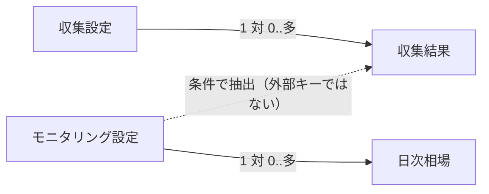
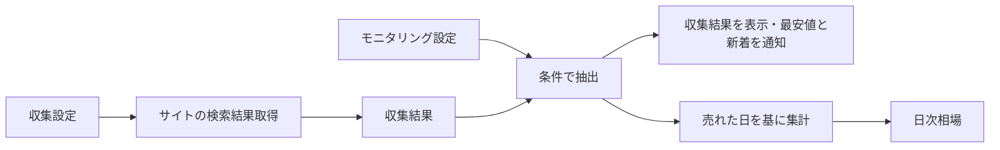
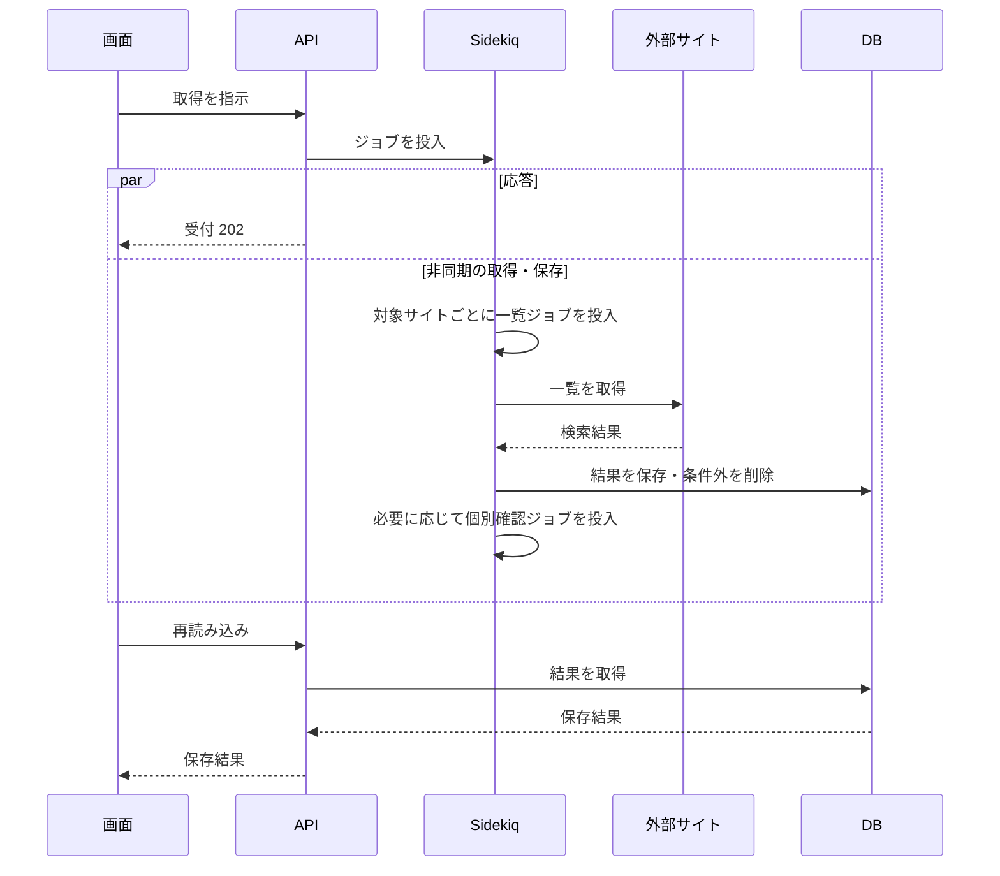

# 商品モニタリング

商品モニタリングを開発・運用する人向けに、外部仕様と内部仕様を説明する。操作は[商品モニタリングの操作](operations.md)を参照する。

収集設定に検索ワードとサイト、または検索結果URLと共通の条件を登録し、取得した収集結果をモニタリング設定で絞り込み、日ごとに集計する。

## 文書の見方

用語の定義は[用語集](../../../GLOSSARY.md)を参照する。

このページは外部仕様と内部仕様に分ける。外部仕様は画面から見える振る舞いと、利用者が当たる上限である。内部仕様は保存と抽出、取得方式、クラス配置、API である。画面の操作手順は[操作](operations.md)、カラム・インデックスは[ER](../../database/er.md)、テーブル間の外部キーは[アソシエーション](../../database/association.md)を参照する。実際の動作とスキーマの確認には実装と `volumes/backend/db/schema.rb` を使う。

## 外部仕様

画面を使う人から見える振る舞いと、利用者が当たる上限を書く。操作の手順は[操作](operations.md)を参照する。パス、JSON、ステータスコードは書かない。

### 画面から見える振る舞い

収集設定でサイトから集めた収集結果を、モニタリング設定の抽出条件で選んで表示する。在庫は集めた時点のもので、リアルタイムではない。

モニタリング設定の一覧（`/product-monitoring/monitors`）の各行は、抽出条件に合う収集結果を新着順に最大8件出す。売り切れを含む。売れた日が無い売り切れは出ない。販売状態の切り替えも並び替えも無い。あわせて、販売中の最安値と、直近の平均取引価格を出す。

モニタリング設定の詳細（`/product-monitoring/monitors/<id>`）は、抽出条件に合う保存済みの収集結果を件数の上限なく出す。除外した収集結果は出ない。同じ出品は1件にまとめる。販売状態は「すべて」「販売中」「売り切れ」で切り替え、各ボタンに件数を出す。販売中は売り切れでないもの（販売状態が不明なものを含む）。売り切れは売り切れのもの。並びは「新着順」「価格の安い順」「価格の高い順」。新着順では、売れた日が無い売り切れを末尾に置く。価格が同じときは、id の大きい行を先にする。

収集設定の詳細は、その収集設定の保存済みの収集結果を対象に、同じ三つの販売状態と三つの並びで切り替える。

### 利用者が当たる上限

- モニタリング設定の一覧の収集結果は最大8件。詳細の収集結果に件数の上限はない。
- 検索結果URLは最大5件。1件のURLは最大5ページ、1ページ100件。取得は1 URLあたり60秒、1回の取得ジョブは30分。
- 最安値通知と新着通知に載せる収集結果は最大5件、本文は最大2000文字。新着通知は取得から最大で約15分遅れる。
- 日次相場の手動集計は直近30日。取引の取得期間は、開始日から終了日までの日数が90未満。
- 通知本文が送信先の都合で届かないことと、画面の収集結果がサイトの今の在庫と違うことはある。

## 内部仕様

### 設計方針

- 既存の計測対象管理とは独立した新規のテーブル群とし、既存テーブルを参照しない。旧テーブルの扱いはこの機能の仕様には含めない。
- カテゴリは持たない。カテゴリなどの絞り込みは検索結果URLで指定する。
- 将来の賃貸ページのクロールと区別するため、テーブル名は `product_monitoring_`、ドメイン名は「商品」で始める。
- 必須語・除外語・価格帯は収集設定の全URLで共有する。サイトごとに条件を変える構成は、旧スキーマで使われなかったため採らない。
- 収集結果は収集設定に属し、URLには属さない。同じ設定の複数URLで見つかった出品は1行にし、別の設定で見つかれば設定ごとに行ができる。
- モニタリング設定は収集設定に紐付けず、全収集設定の収集結果を条件で絞り込む。
- 集める側とモニタリングする側は互いのコードを参照しない。保存条件・抽出条件（価格帯・必須語・除外語）の判定は設定ごとの Matcher（`CrawlSetting::Matcher` と `Monitor::Matcher`）が、入力の検証は設定ごとの Writer（`CrawlSetting::Writer` と `Monitor::Writer`）が持ち、両側で共有しない。Writer は保存時だけ検証し、取得・検索・通知・集計（`Crawling`・`Search`・`Notification`・`Aggregation`）とは別の名前空間に置く。モデルには判定を置かない。必須語・除外語は各50件、各255文字。
- モニタリングする側は収集結果を読むだけで、書き込まない。読む項目は、販売状態（`sold`）、売れた日（`sold_at`）、新着順の時刻（`recency_at`）、除外日時（`excluded_at`）、価格・名前などの表示項目と、出品の同一性（`platform` と `external_id`）である。集める側でこれらの意味を変えるときは、商品モニタリングへの影響を確認する。
- 出品の同一性の判定は揃っていない。最安値・収集結果の表示・新着通知は `platform` と `external_id` の組、日次相場の集計は `external_id` だけで重複をまとめる。トレファクは販売状態を一覧から判定できないため常に販売中として保存し、売れた出品が最安値の候補に残り続ける。いずれも未対応。

### データの関係

| データ | テーブル | 役割 |
| --- | --- | --- |
| 収集設定 | `product_monitoring_crawl_settings` | 検索元と取得結果に適用する条件を持つ |
| 収集結果 | `product_monitoring_crawl_results` | 収集設定ごとの出品、価格、販売状態、除外状態を持つ |
| モニタリング設定 | `product_monitoring_monitors` | 複数の収集設定にまたがる表示・集計・通知の条件を持つ |
| 日次相場 | `product_monitoring_daily_market_prices` | モニタリング設定ごとの日次集計を持つ |



収集結果は一つの収集設定に属し、日次相場は一つのモニタリング設定に属する。モニタリング設定と収集設定の間に外部キーはなく、全設定の収集結果を条件で選ぶ。各テーブルの関連の正本は[アソシエーション](../../database/association.md)に置く。

### 処理の全体像



収集設定を基に外部サイトから取得し、結果を保存する。モニタリング設定は保存済みの結果を対象に表示・通知・集計する。取得、通知評価、日次相場の集計はそれぞれ別のタイミングで動くため、保存結果や日次相場が常に最新の外部サイトの状態を表すわけではない。実行間隔と判定条件は[処理と制約](#処理と制約)を参照する。

#### 取得して保存する流れ



手動操作では API がジョブを投入した後に `202` を返し、取得と保存は非同期に行う。取得と保存はサイトごとの一覧ジョブが行い、個別確認もサイトごとのジョブで行う。図は処理の関係を示しており、`202` の応答とジョブの開始の前後は保証されず、再読み込み時にジョブが完了しているとも限らない。取得後は条件に合う結果を保存し、必要な出品について個別確認ジョブを投入する。定期取得も同じ保存処理を使う。個別確認の対象や取得の失敗時の扱いは[処理と制約](#処理と制約)に記す。

### 処理と制約

#### 検索と通知

- 最安検索は価格順に小分けで読み、最安価格を超えた時点で終了する。バッチ間の一貫性は MySQL の `REPEATABLE READ` 分離レベルに依存する。
- 一覧の検索は `recency_at` の降順（同じ時刻は id の降順）に小分けで読み、`recency_at` がない行は除く。販売中と販売状態が不明な行の `recency_at` は初めて保存した時刻で、再保存では進めない。売り切れで `sold_at` がある行は `sold_at`、売れた日がない売り切れは `recency_at` を空にして 8 件に入れない。条件に一致する重複のない収集結果が8件に達すると終了する。8件に満たない場合は価格帯内の候補を売り切れも含めて全件走査するため、候補数や設定数が増えると表示に時間がかかる。バッチ間の一貫性は MySQL の `REPEATABLE READ` 分離レベルに依存する。
- 詳細の検索は、一覧と同じく価格帯を SQL で絞り、語句を `Monitor::Matcher` で小分けに判定する。除外されていない収集結果を `platform` と `external_id` の組で重複なくすべて返し、8件では止めない。並びは `recency_at` の降順、同じ時刻は id の降順で、`recency_at` がない行（売れた日が未取得の売り切れ）は末尾に置き、その中も id の降順にする。この行は走査の末尾にあるため、件数で止めると詳細の売り切れから落ちる。販売中は `sold` が true でないもの、売り切れは `sold` が true のもの。価格順は価格の昇順または降順で、同じ価格は id の降順。候補数が多いと詳細の表示に時間がかかる。バッチ間の一貫性は MySQL の `REPEATABLE READ` 分離レベルに依存する。
- 定期評価は設定ごとのジョブに分割する。日次相場の集計と同じ Sidekiq プロセスを使うため、個別の通知処理中は日次相場の集計も待つ場合がある。
- 同じ設定の重複通知と条件変更との競合を防ぐため、Discordへの送信中も設定の行ロックを保持する。送信先の応答が遅いと、その設定の編集・削除は送信完了まで待つ。
- 商品モニタリングの一覧は、全収集設定の保存済み結果から除外されていない収集結果を売り切れも含めて条件で絞り込み、新着順に最大8件表示する。詳細は同じ条件に合う保存済みを件数の上限なく表示し、販売状態と並びを切り替えられる。一覧の最安値は最安検索で求め、直近の平均取引価格は平均取引価格のある最新の日の日次相場から求める。取得結果に現れなくなった出品も保存されるため、表示する収集結果に古い情報が含まれることがあり、リアルタイムの在庫を保証しない。
- 最安値通知は、有効なモニタリング設定を10分ごとに評価する。初回評価で基準を保存し、その後、最安値または最安値に並ぶ収集結果の組が変化して収集結果がある場合に通知する。最安値に並ぶ収集結果がなくなった場合は通知せず空の基準に更新し、再び現れた場合は通知する。条件・有効状態の変更後は基準をリセットし、次の評価を初回として扱う。送信先が未設定または形式不正の場合は通知せず、評価時点の結果を基準に保存する。最後の評価後に生じた変化は、送信先の設定後に通知される場合がある。有効な送信先への送信が失敗した場合は基準を更新せず次回再試行する。通知に含める収集結果は最大5件、本文は最大2000文字。送信結果が確認できなかった場合などは、再試行により通知が重複することがある。
- 新着通知を有効にしたモニタリング設定を、最安値通知と同じジョブで10分ごとに評価する。前回評価した範囲の終わりより後から、評価時刻の5分前までに保存された、条件に一致する除外されていない販売中（`sold = false`）の収集結果を新着とし、新しい順に最大5件と件数を通知する。同じ出品（`platform` と `external_id` の組）が範囲より前に保存されていれば、別の収集設定が後から保存しても新着にしない。初回評価と、条件・新着通知の有効状態の変更後の評価では、範囲の終わりだけを保存して通知しない。送信先が未設定または形式不正の場合は通知せず範囲を進め、有効な送信先への送信が失敗した場合は範囲を進めず次回まとめて再試行する。
- 新着通知の範囲は保存日時（`created_at`）で区切る。保存は別プロセスで並列に動き、ID の順に確定するとは限らないため、ID ではなく日時を使い、直近5分の行は保存のトランザクションが確定するまで次の評価に回す。このため通知は最大で約15分遅れ、5分以上かかる保存のトランザクションがあるとその行を取りこぼす。
- 新着通知は、サイトに掲載された日時ではなく、収集結果として初めて保存された日時で判定する。新しい収集設定を追加するか、収集設定の検索URL・保存条件を広げると、その収集で初めて保存された収集結果は、サイト上では古くても新着として通知される。`CrawlResultCleaner` が削除した収集結果が、条件を戻したことなどで再び保存された場合も新着になる。いずれも未対応。

#### 取得と集計

- 取引がない日の日次相場は平均取引価格がなく、取引件数は0。期間の平均取引価格は日ごとの平均を取引件数で重み付けする。
- 取得は画面からの手動実行に加え、有効な収集設定を10分ごとにSidekiqで実行する。集計は画面からの手動実行に加え、全モニタリング設定について毎日0時に直近30日分をSidekiqで実行する。
- 旧相場設定は参照せず、既存の収集結果から集計する。モニタリング設定の抽出条件を変更すると、それまでの日次相場は削除され、次の集計で更新される。
- 検索結果URLは最大5件。検索ワードからは選択サイトごとにURLを組み立て、ヤフオクは出品中と落札相場の2件を検索する。組み立てたURLに価格帯は含めず、画面にも表示しない。1 URLにつき最大5ページ・1ページ100件（最大500件）。次ページがない場合に終了する。結果が0件のページでも次ページがあれば続ける。途中の取得が失敗したURLは失敗とする。1 URLの取得は60秒を上限とする。取得はサイトごとのジョブで行い、ジョブ全体は30分を上限とする。手動取得は設定の有効・無効にかかわらず実行する。
- イオシスの機種グループ検索（`t=g`）は登録できない。`t=g` のない個別出品の検索URLを使う。単一の価格として解釈できない出品は保存しない。

#### 絞り込み・除外・削除

- 必須語はAND、除外語はOR。カンマ・改行で複数指定する。出品名との部分一致で判定し、比べる前に両方をNFKCで正規化して小文字にし、空白を除く（`iPad Pro` は `ｉＰａｄＰｒｏ` に一致する）。収集設定とモニタリング設定で同じ判定にそろえる。判定は `CrawlSetting::Matcher` と `Monitor::Matcher` に別々にあるので、変えるときは両方を同時に直す。価格は上下限を含み、空欄は無制限。
- 収集結果の除外は収集結果の行ごとに `excluded_at` を設定し、通常の結果表示と集計から除く。同じ設定で再取得するときは `external_id` で除外を判定する。
- 収集結果の削除は選択した収集結果の行だけを消す。同じ出品が別の設定にあれば残り、再取得されると再登録される。保存済みの日次相場は変更せず、次回の集計で反映する。収集結果と商品モニタリングのカードから操作できる。
- 商品モニタリングからの除外も表示元の行に適用する。同じ出品が別の収集設定に保存されている場合、その行は除外されず、商品モニタリングに再表示されることがある。取り消しは元の収集設定の更新モーダルで行う。
- 取得して保存するとき、保存済みの結果のうち現在の条件に一致しないものを、除外済みの行も含めて削除する。今回の検索結果に出なかった出品は、条件に一致していれば残す。
- 収集設定の更新で必須語・除外語・価格帯のいずれかを変えたときも、同じ削除を更新と同じトランザクションで行う。名前・有効状態・検索ワード・サイト・検索結果URLだけの変更では削除しない。日次相場は再計算せず、次の集計で反映する。

#### 日次相場の集計と販売状態

- 日次相場は、除外されておらず条件に一致する収集結果のうち、`sold_at` が集計期間に入るものを `external_id` で1件にまとめ、日ごとに平均する。対象の取り出しは `ProductMonitoring::Aggregation::Transactions` にまとめ、集計と取引のAPIで共有する。
- メルカリは一覧の売り切れ表示と個別ページの JSON-LD の在庫状態から販売状態を確認し、売れた日は相対表示から日単位で推定する。一覧から消えた販売中または販売状態不明の出品と、売り切れで売れた日が不明な出品は、最終更新から3時間経過すると個別確認の候補になる。一覧で初めて売り切れと確認した出品は、待たずに候補になる。個別ページの状態を判定できない場合や再試行を使い切った場合は、販売状態を変えず確認日時を更新する。イオシス・トレファクは一覧にある出品を販売中とし、じゃんぱらは一覧の売り切れ表示を反映する。これら3サイトでは売れた日は取得しない。サムネイルはイオシスの一覧の画像URL、メルカリは出品IDから組み立てたURLを保存する。
- じゃんぱらの一覧の売り切れ表示は、価格がなくても検索結果にある既存の出品の販売状態に反映する。売れた日と更新日時はこの反映では変更しない。
- イオシスとじゃんぱらは、そのサイトの検索元が1件以上ありすべての取得が成功し、ページ上限で打ち切られなかった場合、検索結果から消えて最終更新から3時間以上経った出品を売り切れにする。検索結果に戻った販売中の出品は販売中に戻す。価格がない出品も存在判定に含め、この判定では売れた日と更新日時を変更しない。
- Yahoo!フリマも一覧の sold 画像と個別ページの JSON-LD から販売状態を確認し、時計アイコンの更新日時を既存クローラーと同じ基準で日単位に換算する。日時が表示されない場合は不明のままとする。個別確認の候補と間隔はメルカリと同じ。個別確認は設定ごと・サイトごとに1回最大50件。画像URLは一覧から取得する。
- 取得元が失敗しても、売れた日が不明な出品は個別確認する。一覧から消えた出品は、そのサイトの取得元がすべて成功した場合に確認する（ページ上限による打ち切りは個別確認を妨げない）。取得はサイトごとのジョブで行うため、別サイトの失敗は影響しない。
- ヤフオクは出品中の一覧を販売中、落札相場の一覧を売り切れとし、落札相場の終了日時を売れた日として保存する。即決価格と終了日時は一覧から取得し、個別確認は行わない。

### 取得方式と制限

入力URLをHTTPSの対応ホスト・検索パスに限定する。取得は全サイトとも本機能の Playwright クライアント（`Crawling::Client`）を使い、サーバーのIPから直接取得しないよう、プロキシ一覧から選んだプロキシ（`Crawling::Proxy`）を経由する。広告・計測などの通信は `Crawling::RequestBlocklist` で止める。従来の商品計測（`Crawl::*`）のクライアントは使わない。プロキシの一覧を取得できずプロキシが無いときは、接続せずに取得を失敗にする。イオシス・じゃんぱら・トレファクは JavaScript なしで一覧が描画されるので、スクリプトを遮断して取得し、遷移後の HTTPS ホストと描画後 HTML の10 MiB 上限を検証する。サイトに拒否されるプロキシがあるため、この3サイトは非2xxの応答なら接続し直して別のプロキシで最大5回試す。メルカリはJavaScriptを実行して描画し、ブラウザのリダイレクトやサブリソース通信を許可する。各ページの遷移後に最終URLがHTTPSの `jp.mercari.com` であることを確認し、描画後のHTMLが10 MiBを超えた場合は失敗とする。メルカリの応答にはストリーミングのサイズ上限を適用しない。いずれも取得したHTMLはNokogiriで解析する。

じゃんぱらは WAF による拒否を避けるため、新しい User-Agent とトップページの Referer を指定して検索結果を取得する。一覧の SRCODE または ITMCODE の商品グループを1出品とし、価格はグループの下限価格を保存する。個別の店舗在庫は確認せず、一覧の売り切れ表示を反映する。

トレファクは一覧の `/item/<数字>` を出品IDとし、画像の代替テキストを出品名、税込の表示価格を価格として保存する。一覧には売り切れの出品も並ぶが価格が表示されないため取り込まず、販売中の出品だけを保存する。売れた日は一覧・個別ページのどちらにも表示されないので、個別確認は行わない。次ページは `page` を1つずつ増やして取得する。売り切れだけのページは空結果として扱い、次ページがあれば取得を続ける。

#### コードとジョブの構成

集める側は `ProductMonitoring::Crawling`、モニタリングする側は `ProductMonitoring::Search`・`ProductMonitoring::Notification`・`ProductMonitoring::Aggregation` に置く。集める側は、サイトごとに一覧用と個別確認用のクラスとジョブを持つ。

| サイト | 一覧（`<サイト>::ListPage::`） | 個別確認（`<サイト>::DetailPage::`） |
| --- | --- | --- |
| メルカリ（`Mercari`） | `SearchUrl` / `Crawler` / `Parser` / `Syncer` / `SyncJob` | `Crawler` / `Syncer` / `SyncJob` |
| Yahoo!フリマ（`YahooFleamarket`） | `SearchUrl` / `Crawler` / `Syncer` / `SyncJob` | `Crawler` / `Syncer` / `SyncJob` |
| ヤフオク（`YahooAuction`） | `SearchUrl` / `Crawler` / `Parser` / `Syncer` / `SyncJob` | なし |
| イオシス（`Iosys`） | `SearchUrl` / `Crawler` / `Syncer` / `SyncJob` | なし |
| じゃんぱら（`Janpara`） | `SearchUrl` / `Crawler` / `Parser` / `Syncer` / `SyncJob` | なし |
| トレファク（`TreasureFactory`） | `SearchUrl` / `Crawler` / `Syncer` / `SyncJob` | なし |

- `SearchUrl` は、ホスト・検索パス・サイト名と、検索ワードからの検索結果URLの組み立て、登録する検索結果URLの検証を持つ。
- 一覧の `Crawler` は、設定の検索結果URLのうちそのサイトの分を、ページを送りながら取得して出品を返す。失敗したURLはログに残して次のURLへ進み、全URLが失敗したらジョブを失敗にして再試行する。イオシス・じゃんぱら・メルカリ・Yahoo!フリマは、全URLを最後のページまで取得できたかも返す。メルカリ・ヤフオク・じゃんぱらは1ページの解析を `Parser` に分ける。1ページの件数が上限（実際の件数より大きい値）を超えたときと、メルカリで全セルを描画しきれなかったときも、一覧を最後まで取得できなかったとする。
- 一覧の `Syncer` は、取得した出品のうち収集設定の条件に一致するものを保存（upsert と販売状態の更新）し、`CrawlResultCleaner` で条件外を削除する。保存の処理はサイトごとの `Syncer` に置く。イオシス・じゃんぱらの `Syncer` は一覧の売り切れ表示と一覧から消えた出品を販売状態に反映し、メルカリ・Yahoo!フリマの `Syncer` は個別確認の候補を選んで詳細ジョブを積む。
- 個別確認の `Crawler` は個別ページから販売状態と売れた日を返し、個別確認の `Syncer` が同じ出品の行に反映する。詳細ジョブは `Syncer` を呼ぶだけである。
- 条件外の削除は設定更新時にも `CrawlResultCleaner` で行う。
- `UrlRouter` は、収集設定の検索ワード・サイト・検索結果URLを、`PLATFORMS` に並べた各プラットフォームの `SearchUrl` で検証し、サイトごとに取得するURLへ振り分ける。定期取得・手動取得が対象サイトを、各サイトの `Crawler` が取得するURLを、設定の保存時は URL の検証を、これで行う。対応しない URL は取得時も失敗にする。
- 定期取得（`Crawling::EnqueueSyncJob`）は有効な設定ごとに、手動取得（`POST /api/v1/product_monitoring/crawl_settings/:id/sync`）はその設定について、対象サイトの一覧ジョブを直接積む。ジョブもサービスと同じく、集める側は `Crawling`、モニタリングする側は `Notification`・`Aggregation` の下に置く。
- キューはジョブごとに分かれ、名前はクラス名から `Crawling`・`Notification`・`Aggregation` を除いて作る（`Crawling::Mercari::ListPage::SyncJob` なら `product_monitoring_mercari_list_page_sync_job`）。Sidekiq のダッシュボードや Datadog で、サイトと一覧・個別確認の別を見分けられる。定期取得と一覧ジョブは `crawl_process`、詳細ジョブは `crawl_process_2`、集計と通知は `general_process` の設定で処理する。
- ブラウザの接続は `Client` を使う。遷移後の URL と HTML サイズの確認、失敗の判定は各サイトの `Crawler` が行う。サイトを追加するときは、そのサイトの `ListPage` 一式を追加して `UrlRouter::PLATFORMS` に登録し、ジョブのキューを `config/sidekiq` に追加する。

Yahoo!フリマはメルカリと同じく JavaScript を実行して描画し、遷移後の HTTPS ホストと描画後 HTML の10 MiB 上限を検証する。更新日時の描画に必要な `paypayfleamarket.c.yimg.jp` のスクリプトを許可する。検索一覧の次ページリンクを確認してページ送りする。既存の `Crawl::YahooFleamarket` の一覧は Yahoo!オークションの検索結果を取得するため、本機能の Yahoo!フリマ検索とは取得元と DOM が異なる。

ヤフオクは Playwright で JavaScript と画像の読み込みを許可し、最終 HTTPS ホストと描画後 HTML の10 MiB 上限を検証する。画像を遮断するとサイトがサムネイルをエラー画像に置き換えるため画像の読み込みが必要。既存クローラーと同様に `abatch=1,2` で Yahoo!フリマを除き、一覧表示・100件単位のページ送りを使う。一覧の描画を待ってから HTML を Nokogiri で解析する。外部の表示変更や読み込み失敗により取得できない場合がある。

メルカリの個別ページが404を返した場合、最終URLが要求した出品URLと一致し、本文に「ページが見つかりませんでした」と「お探しのページはURLが間違っているか、削除された可能性があります。」があり、商品詳細コンテナがないときに限り、公開ページが見つからないと判定する。Yahoo!フリマは、最終URLの一致と404に加え、商品詳細を示す構造化データがなく、メイン領域の案内に「この商品は存在しません」と表示されるときに公開ページ不存在と判定する。これらの判定とメルカリの2xxの削除表示では、同じ出品の全収集設定の行を削除し、その行からの個別確認を終了する。削除した行に売れた日があれば取引の表示と次回の日次相場の集計にも影響する。再取得した出品は再登録される場合がある。不存在を確認できない404やその他の非2xxでは行を保持して再試行し、再試行を使い切ると確認日時を更新して3時間後に再び個別確認の候補になる。

サイト側の拒否やDOMの不一致は失敗とし、成功したようなサンプル結果へ置き換えない。

画面に返す取得失敗の文言は固定である。

### API


日時は ISO 8601 の文字列、日付は `YYYY-MM-DD`。レスポンスに `last_lowest_signature` と `newest_notified_until` は含まれない。


#### `GET /api/v1/product_monitoring/crawl_settings`

保存済みの収集設定を id の新しい順に返す。

リクエストボディなし。

**200**

| 名前 | 型 | 説明 |
| --- | --- | --- |
| crawl_settings | array | 収集設定 |
| crawl_settings[].id | integer | 収集設定の id |
| crawl_settings[].name | string | 名前。1〜255文字 |
| crawl_settings[].enabled | boolean | 取得を定期実行するか |
| crawl_settings[].search_keyword | string または null | 検索ワード。無いときは null |
| crawl_settings[].platforms | string の配列 | サイト。`mercari`、`yahoo_fleamarket`、`yahoo_auction`、`iosys`、`janpara`、`treasure_factory` |
| crawl_settings[].search_urls | string の配列 | 検索結果URL |
| crawl_settings[].required_keywords | string の配列 | 必須語 |
| crawl_settings[].negative_keywords | string の配列 | 除外語 |
| crawl_settings[].min_price | integer または null | 価格の下限。下限なしは null |
| crawl_settings[].max_price | integer または null | 価格の上限。上限なしは null |
| crawl_settings[].created_at | string | 作成日時。ISO 8601 |
| crawl_settings[].updated_at | string | 更新日時。ISO 8601 |

```json
{
  "crawl_settings": [
    {
      "id": 1,
      "name": "phone",
      "enabled": true,
      "search_keyword": "phone",
      "platforms": [
        "mercari"
      ],
      "search_urls": [
        "https://jp.mercari.com/search?keyword=phone"
      ],
      "required_keywords": [
        "phone"
      ],
      "negative_keywords": [
        "case"
      ],
      "min_price": 1000,
      "max_price": 50000,
      "created_at": "2026-11-20T09:00:00.000+09:00",
      "updated_at": "2026-11-20T09:00:00.000+09:00"
    }
  ]
}
```

#### `POST /api/v1/product_monitoring/crawl_settings`

収集設定を検証して保存し、保存した収集設定を返す。

| 場所 | 名前 | 型 | 必須 | 説明 |
| --- | --- | --- | --- | --- |
| body | name | string | 必須 | 名前。1〜255文字 |
| body | enabled | boolean | 任意 | 省略時は false |
| body | search_keyword | string または null | 任意 | 255文字以内。検索ワードとサイトは両方指定するか両方空 |
| body | platforms | string の配列 | 任意 | 省略時は空。`mercari`、`yahoo_fleamarket`、`yahoo_auction`、`iosys`、`janpara`、`treasure_factory` |
| body | search_urls | string の配列 | 任意 | 省略時は空。5件まで、1件2048バイトまで。検索ワードとサイトが空なら1件以上必要 |
| body | required_keywords | string の配列 | 任意 | 省略時は空。各255文字、50件まで |
| body | negative_keywords | string の配列 | 任意 | 省略時は空。各255文字、50件まで |
| body | min_price | integer または null | 任意 | 0以上2147483647以下。省略または null は下限なし |
| body | max_price | integer または null | 任意 | 0以上2147483647以下。省略または null は上限なし。下限以下にはできない |

```json
{
  "name": "phone",
  "enabled": true,
  "search_keyword": "phone",
  "platforms": [
    "mercari"
  ],
  "search_urls": [
    "https://jp.mercari.com/search?keyword=phone"
  ],
  "required_keywords": [
    "phone"
  ],
  "negative_keywords": [
    "case"
  ],
  "min_price": 1000,
  "max_price": 50000
}
```

**200**

| 名前 | 型 | 説明 |
| --- | --- | --- |
| id | integer | 収集設定の id |
| name | string | 名前。1〜255文字 |
| enabled | boolean | 取得を定期実行するか |
| search_keyword | string または null | 検索ワード。無いときは null |
| platforms | string の配列 | サイト。`mercari`、`yahoo_fleamarket`、`yahoo_auction`、`iosys`、`janpara`、`treasure_factory` |
| search_urls | string の配列 | 検索結果URL |
| required_keywords | string の配列 | 必須語 |
| negative_keywords | string の配列 | 除外語 |
| min_price | integer または null | 価格の下限。下限なしは null |
| max_price | integer または null | 価格の上限。上限なしは null |
| created_at | string | 作成日時。ISO 8601 |
| updated_at | string | 更新日時。ISO 8601 |

```json
{
  "id": 1,
  "name": "phone",
  "enabled": true,
  "search_keyword": "phone",
  "platforms": [
    "mercari"
  ],
  "search_urls": [
    "https://jp.mercari.com/search?keyword=phone"
  ],
  "required_keywords": [
    "phone"
  ],
  "negative_keywords": [
    "case"
  ],
  "min_price": 1000,
  "max_price": 50000,
  "created_at": "2026-11-20T09:00:00.000+09:00",
  "updated_at": "2026-11-20T09:00:00.000+09:00"
}
```

**400**

| 名前 | 型 | 説明 |
| --- | --- | --- |
| error.code | integer | 400 |
| error.message | string | 名前が1〜255文字でない、価格が0以上2147483647以下の整数でない、最低価格が最高価格より高い、語句が文字列でないか255文字を超えるか51件以上、有効状態が true でも false でもない、ときの文言。またはサイトの値が取り得る値以外、検索結果URLが5件超・2048バイト超・重複・HTTPSの検索URLでない、ホストまたはパスが非対応、クエリが必要、検索ワードとサイトの片方だけ、検索手段が一つもない、Yahoo!フリマの検索ワードが空または `/` と制御文字を含む、イオシスの `t=g`、じゃんぱらの `KEYWORDS` が空、ときの文言 |
| error.details | array | 空配列 |

```json
{
  "error": {
    "code": 400,
    "message": "名前は1〜255文字で入力してください",
    "details": []
  }
}
```

#### `GET /api/v1/product_monitoring/crawl_settings/:id`

id で指定した収集設定を返す。

| 場所 | 名前 | 型 | 必須 | 説明 |
| --- | --- | --- | --- | --- |
| path | id | integer | 必須 | 収集設定の id |

```
/api/v1/product_monitoring/crawl_settings/1
```

リクエストボディなし。

**200**

| 名前 | 型 | 説明 |
| --- | --- | --- |
| id | integer | 収集設定の id |
| name | string | 名前。1〜255文字 |
| enabled | boolean | 取得を定期実行するか |
| search_keyword | string または null | 検索ワード。無いときは null |
| platforms | string の配列 | サイト。`mercari`、`yahoo_fleamarket`、`yahoo_auction`、`iosys`、`janpara`、`treasure_factory` |
| search_urls | string の配列 | 検索結果URL |
| required_keywords | string の配列 | 必須語 |
| negative_keywords | string の配列 | 除外語 |
| min_price | integer または null | 価格の下限。下限なしは null |
| max_price | integer または null | 価格の上限。上限なしは null |
| created_at | string | 作成日時。ISO 8601 |
| updated_at | string | 更新日時。ISO 8601 |

```json
{
  "id": 1,
  "name": "phone",
  "enabled": true,
  "search_keyword": "phone",
  "platforms": [
    "mercari"
  ],
  "search_urls": [
    "https://jp.mercari.com/search?keyword=phone"
  ],
  "required_keywords": [
    "phone"
  ],
  "negative_keywords": [
    "case"
  ],
  "min_price": 1000,
  "max_price": 50000,
  "created_at": "2026-11-20T09:00:00.000+09:00",
  "updated_at": "2026-11-20T09:00:00.000+09:00"
}
```

**404**

| 名前 | 型 | 説明 |
| --- | --- | --- |
| error.code | integer | 404 |
| error.message | string | `Not Found.` |
| error.details | array | 空配列 |

```json
{
  "error": {
    "code": 404,
    "message": "Not Found.",
    "details": []
  }
}
```

#### `PUT /api/v1/product_monitoring/crawl_settings/:id`

id で指定した収集設定を検証して保存し、保存後の収集設定を返す。必須語・除外語・価格帯を変えたときは、新しい条件に合わない保存済みの収集結果を削除する。

| 場所 | 名前 | 型 | 必須 | 説明 |
| --- | --- | --- | --- | --- |
| path | id | integer | 必須 | 収集設定の id |
| body | name | string | 必須 | 名前。1〜255文字 |
| body | enabled | boolean | 任意 | 省略時は false |
| body | search_keyword | string または null | 任意 | 255文字以内。検索ワードとサイトは両方指定するか両方空 |
| body | platforms | string の配列 | 任意 | 省略時は空。`mercari`、`yahoo_fleamarket`、`yahoo_auction`、`iosys`、`janpara`、`treasure_factory` |
| body | search_urls | string の配列 | 任意 | 省略時は空。5件まで、1件2048バイトまで。検索ワードとサイトが空なら1件以上必要 |
| body | required_keywords | string の配列 | 任意 | 省略時は空。各255文字、50件まで |
| body | negative_keywords | string の配列 | 任意 | 省略時は空。各255文字、50件まで |
| body | min_price | integer または null | 任意 | 0以上2147483647以下。省略または null は下限なし |
| body | max_price | integer または null | 任意 | 0以上2147483647以下。省略または null は上限なし。下限以下にはできない |

```json
{
  "name": "phone",
  "enabled": true,
  "search_keyword": "phone",
  "platforms": [
    "mercari"
  ],
  "search_urls": [
    "https://jp.mercari.com/search?keyword=phone"
  ],
  "required_keywords": [
    "phone"
  ],
  "negative_keywords": [
    "case"
  ],
  "min_price": 1000,
  "max_price": 50000
}
```

**200**

| 名前 | 型 | 説明 |
| --- | --- | --- |
| id | integer | 収集設定の id |
| name | string | 名前。1〜255文字 |
| enabled | boolean | 取得を定期実行するか |
| search_keyword | string または null | 検索ワード。無いときは null |
| platforms | string の配列 | サイト。`mercari`、`yahoo_fleamarket`、`yahoo_auction`、`iosys`、`janpara`、`treasure_factory` |
| search_urls | string の配列 | 検索結果URL |
| required_keywords | string の配列 | 必須語 |
| negative_keywords | string の配列 | 除外語 |
| min_price | integer または null | 価格の下限。下限なしは null |
| max_price | integer または null | 価格の上限。上限なしは null |
| created_at | string | 作成日時。ISO 8601 |
| updated_at | string | 更新日時。ISO 8601 |

```json
{
  "id": 1,
  "name": "phone",
  "enabled": true,
  "search_keyword": "phone",
  "platforms": [
    "mercari"
  ],
  "search_urls": [
    "https://jp.mercari.com/search?keyword=phone"
  ],
  "required_keywords": [
    "phone"
  ],
  "negative_keywords": [
    "case"
  ],
  "min_price": 1000,
  "max_price": 50000,
  "created_at": "2026-11-20T09:00:00.000+09:00",
  "updated_at": "2026-11-20T09:00:00.000+09:00"
}
```

**400**

| 名前 | 型 | 説明 |
| --- | --- | --- |
| error.code | integer | 400 |
| error.message | string | 名前が1〜255文字でない、価格が0以上2147483647以下の整数でない、最低価格が最高価格より高い、語句が文字列でないか255文字を超えるか51件以上、有効状態が true でも false でもない、ときの文言。またはサイトの値が取り得る値以外、検索結果URLが5件超・2048バイト超・重複・HTTPSの検索URLでない、ホストまたはパスが非対応、クエリが必要、検索ワードとサイトの片方だけ、検索手段が一つもない、Yahoo!フリマの検索ワードが空または `/` と制御文字を含む、イオシスの `t=g`、じゃんぱらの `KEYWORDS` が空、ときの文言 |
| error.details | array | 空配列 |

```json
{
  "error": {
    "code": 400,
    "message": "最低価格は最高価格以下にしてください",
    "details": []
  }
}
```

**404**

| 名前 | 型 | 説明 |
| --- | --- | --- |
| error.code | integer | 404 |
| error.message | string | `Not Found.` |
| error.details | array | 空配列 |

```json
{
  "error": {
    "code": 404,
    "message": "Not Found.",
    "details": []
  }
}
```

#### `DELETE /api/v1/product_monitoring/crawl_settings/:id`

id で指定した収集設定を削除する。

| 場所 | 名前 | 型 | 必須 | 説明 |
| --- | --- | --- | --- | --- |
| path | id | integer | 必須 | 収集設定の id |

```
/api/v1/product_monitoring/crawl_settings/1
```

リクエストボディなし。

**200**

| 名前 | 型 | 説明 |
| --- | --- | --- |
| （ボディ） | object | 空オブジェクト |

```json
{}
```

**404**

| 名前 | 型 | 説明 |
| --- | --- | --- |
| error.code | integer | 404 |
| error.message | string | `Not Found.` |
| error.details | array | 空配列 |

```json
{
  "error": {
    "code": 404,
    "message": "Not Found.",
    "details": []
  }
}
```

**400**

| 名前 | 型 | 説明 |
| --- | --- | --- |
| error.code | integer | 400 |
| error.message | string | `Bad Request.`。削除できなかったとき |
| error.details | array | 空配列 |

```json
{
  "error": {
    "code": 400,
    "message": "Bad Request.",
    "details": []
  }
}
```

#### `POST /api/v1/product_monitoring/crawl_settings/:id/sync`

保存済みの条件で取得して保存するジョブを受け付ける。取得は応答のあとで、応答の時点で完了しているとは限らない。

| 場所 | 名前 | 型 | 必須 | 説明 |
| --- | --- | --- | --- | --- |
| path | id | integer | 必須 | 収集設定の id |

```
/api/v1/product_monitoring/crawl_settings/1/sync
```

リクエストボディなし。

**202**

| 名前 | 型 | 説明 |
| --- | --- | --- |
| （ボディ） | object | 空オブジェクト |

```json
{}
```

**404**

| 名前 | 型 | 説明 |
| --- | --- | --- |
| error.code | integer | 404 |
| error.message | string | `Not Found.` |
| error.details | array | 空配列 |

```json
{
  "error": {
    "code": 404,
    "message": "Not Found.",
    "details": []
  }
}
```

**400**

| 名前 | 型 | 説明 |
| --- | --- | --- |
| error.code | integer | 400 |
| error.message | string | 保存済みの検索結果URLが検索URLとして不正なときの文言 |
| error.details | array | 空配列 |

```json
{
  "error": {
    "code": 400,
    "message": "URL must be an HTTPS search URL",
    "details": []
  }
}
```

#### `GET /api/v1/product_monitoring/crawl_results`

除外されていない収集結果、または除外した収集結果だけを返す。`crawl_setting_id` が無いときは収集設定ごとに id の新しい順で最大8件と、販売状態ごとの件数を返す。あるときはその収集設定の行を id の新しい順にすべて返し、`counts` は含まれない。

| 場所 | 名前 | 型 | 必須 | 説明 |
| --- | --- | --- | --- | --- |
| query | crawl_setting_id | integer | 任意 | 収集設定の id。指定するとその設定の全件 |
| query | excluded | boolean | 任意 | 真のとき除外した行だけ。`true`、`1`、`t`、`on`（大文字小文字を問わない）が真。`false`、`0`、`f`、`off` と省略が偽 |

```
/api/v1/product_monitoring/crawl_results?excluded=false
```

リクエストボディなし。

**200**

| 名前 | 型 | 説明 |
| --- | --- | --- |
| crawl_results | array | 収集結果。`crawl_setting_id` が無いときは収集設定ごとに最大8件 |
| crawl_results[].id | integer | 収集結果の id |
| crawl_results[].crawl_setting_id | integer | 収集設定の id |
| crawl_results[].platform | string | サイト |
| crawl_results[].external_id | string | サイト上の出品ID |
| crawl_results[].name | string | 出品名 |
| crawl_results[].product_url | string | 出品URL |
| crawl_results[].thumbnail_url | string または null | サムネイルURL。無いときは null |
| crawl_results[].price | integer | 価格 |
| crawl_results[].buyout_price | integer または null | 即決価格。無いときは null |
| crawl_results[].sold | boolean または null | 売り切れなら true、販売中なら false、不明なら null |
| crawl_results[].sold_at | string または null | 売れた日。無いときは null |
| crawl_results[].ends_at | string または null | 終了日時。無いときは null |
| crawl_results[].excluded_at | string または null | 除外した日時。除外していなければ null |
| crawl_results[].created_at | string | 作成日時。ISO 8601 |
| crawl_results[].updated_at | string | 更新日時。ISO 8601 |
| crawl_results[].recency_at | string または null | 新着順の時刻。売れた日が無い売り切れは null |
| counts | array | `crawl_setting_id` が無いときだけ。販売状態ごとの件数 |
| counts[].crawl_setting_id | integer | 収集設定の id |
| counts[].sold | boolean または null | その件数の販売状態 |
| counts[].count | integer | 件数 |

```json
{
  "crawl_results": [
    {
      "id": 10,
      "crawl_setting_id": 1,
      "platform": "iosys",
      "external_id": "item-1",
      "name": "phone",
      "product_url": "https://example.com/items/item-1",
      "thumbnail_url": null,
      "price": 1200,
      "buyout_price": null,
      "sold": false,
      "sold_at": null,
      "ends_at": null,
      "excluded_at": null,
      "created_at": "2026-11-20T09:00:00.000+09:00",
      "updated_at": "2026-11-20T09:00:00.000+09:00",
      "recency_at": "2026-11-20T09:00:00.000+09:00"
    }
  ],
  "counts": [
    {
      "crawl_setting_id": 1,
      "sold": false,
      "count": 3
    }
  ]
}
```

#### `PATCH /api/v1/product_monitoring/crawl_results/:id`

収集結果の行は残し、除外するか取り消す。

| 場所 | 名前 | 型 | 必須 | 説明 |
| --- | --- | --- | --- | --- |
| path | id | integer | 必須 | 収集結果の id |
| body | excluded | boolean | 必須 | 真で除外、偽で取り消し。`true`、`1`、`t`、`on`（大文字小文字を問わない）が真。`false`、`0`、`f`、`off` と省略が偽 |

```json
{
  "excluded": true
}
```

**200**

| 名前 | 型 | 説明 |
| --- | --- | --- |
| id | integer | 収集結果の id |
| crawl_setting_id | integer | 収集設定の id |
| platform | string | サイト |
| external_id | string | サイト上の出品ID |
| name | string | 出品名 |
| product_url | string | 出品URL |
| thumbnail_url | string または null | サムネイルURL。無いときは null |
| price | integer | 価格 |
| buyout_price | integer または null | 即決価格。無いときは null |
| sold | boolean または null | 売り切れなら true、販売中なら false、不明なら null |
| sold_at | string または null | 売れた日。無いときは null |
| ends_at | string または null | 終了日時。無いときは null |
| excluded_at | string または null | 除外した日時。除外していなければ null |
| created_at | string | 作成日時。ISO 8601 |
| updated_at | string | 更新日時。ISO 8601 |
| recency_at | string または null | 新着順の時刻。売れた日が無い売り切れは null |

```json
{
  "id": 10,
  "crawl_setting_id": 1,
  "platform": "iosys",
  "external_id": "item-1",
  "name": "phone",
  "product_url": "https://example.com/items/item-1",
  "thumbnail_url": null,
  "price": 1200,
  "buyout_price": null,
  "sold": false,
  "sold_at": null,
  "ends_at": null,
  "excluded_at": "2026-11-20T09:00:00.000+09:00",
  "created_at": "2026-11-20T09:00:00.000+09:00",
  "updated_at": "2026-11-20T09:00:00.000+09:00",
  "recency_at": "2026-11-20T09:00:00.000+09:00"
}
```

**404**

| 名前 | 型 | 説明 |
| --- | --- | --- |
| error.code | integer | 404 |
| error.message | string | `Not Found.` |
| error.details | array | 空配列 |

```json
{
  "error": {
    "code": 404,
    "message": "Not Found.",
    "details": []
  }
}
```

**503**

| 名前 | 型 | 説明 |
| --- | --- | --- |
| error.code | integer | 503 |
| error.message | string | `Internal Server Error.`。`excluded` が無いとき |
| error.details | array | 空配列 |

```json
{
  "error": {
    "code": 503,
    "message": "Internal Server Error.",
    "details": []
  }
}
```

#### `DELETE /api/v1/product_monitoring/crawl_results/:id`

指定した収集結果の行を削除する。

| 場所 | 名前 | 型 | 必須 | 説明 |
| --- | --- | --- | --- | --- |
| path | id | integer | 必須 | 収集結果の id |

```
/api/v1/product_monitoring/crawl_results/10
```

リクエストボディなし。

**200**

| 名前 | 型 | 説明 |
| --- | --- | --- |
| （ボディ） | object | 空オブジェクト |

```json
{}
```

**404**

| 名前 | 型 | 説明 |
| --- | --- | --- |
| error.code | integer | 404 |
| error.message | string | `Not Found.` |
| error.details | array | 空配列 |

```json
{
  "error": {
    "code": 404,
    "message": "Not Found.",
    "details": []
  }
}
```

#### `GET /api/v1/product_monitoring/monitors`

保存済みのモニタリング設定を id の新しい順に返し、通知先が設定されているかも返す。

リクエストボディなし。

**200**

| 名前 | 型 | 説明 |
| --- | --- | --- |
| monitors | array | モニタリング設定 |
| monitors[].id | integer | モニタリング設定の id |
| monitors[].name | string | 名前。1〜255文字 |
| monitors[].enabled | boolean | 最安値の通知評価を行うか |
| monitors[].discord_enabled | boolean | 通知設定の保存値 |
| monitors[].newest_notification_enabled | boolean | 新着の通知評価を行うか |
| monitors[].required_keywords | string の配列 | 必須語 |
| monitors[].negative_keywords | string の配列 | 除外語 |
| monitors[].min_price | integer または null | 価格の下限。下限なしは null |
| monitors[].max_price | integer または null | 価格の上限。上限なしは null |
| monitors[].created_at | string | 作成日時。ISO 8601 |
| monitors[].updated_at | string | 更新日時。ISO 8601 |
| discord_configured | boolean | 通知先が使える形で設定されているか |

```json
{
  "monitors": [
    {
      "id": 1,
      "name": "phone",
      "enabled": false,
      "discord_enabled": false,
      "newest_notification_enabled": false,
      "required_keywords": [
        "phone"
      ],
      "negative_keywords": [
        "case"
      ],
      "min_price": 1000,
      "max_price": 50000,
      "created_at": "2026-11-20T09:00:00.000+09:00",
      "updated_at": "2026-11-20T09:00:00.000+09:00"
    }
  ],
  "discord_configured": false
}
```

#### `POST /api/v1/product_monitoring/monitors`

モニタリング設定を検証して保存し、保存した設定を返す。

| 場所 | 名前 | 型 | 必須 | 説明 |
| --- | --- | --- | --- | --- |
| body | name | string | 必須 | 名前。1〜255文字 |
| body | enabled | boolean | 任意 | 省略時は false |
| body | discord_enabled | boolean | 任意 | 省略時は false |
| body | newest_notification_enabled | boolean | 任意 | 省略時は false |
| body | required_keywords | string の配列 | 任意 | 省略時は空。各255文字、50件まで |
| body | negative_keywords | string の配列 | 任意 | 省略時は空。各255文字、50件まで |
| body | min_price | integer または null | 任意 | 0以上2147483647以下。省略または null は下限なし |
| body | max_price | integer または null | 任意 | 0以上2147483647以下。省略または null は上限なし |

```json
{
  "name": "phone",
  "enabled": false,
  "discord_enabled": false,
  "newest_notification_enabled": false,
  "required_keywords": [
    "phone"
  ],
  "negative_keywords": [
    "case"
  ],
  "min_price": 1000,
  "max_price": 50000
}
```

**200**

| 名前 | 型 | 説明 |
| --- | --- | --- |
| id | integer | モニタリング設定の id |
| name | string | 名前。1〜255文字 |
| enabled | boolean | 最安値の通知評価を行うか |
| discord_enabled | boolean | 通知設定の保存値 |
| newest_notification_enabled | boolean | 新着の通知評価を行うか |
| required_keywords | string の配列 | 必須語 |
| negative_keywords | string の配列 | 除外語 |
| min_price | integer または null | 価格の下限。下限なしは null |
| max_price | integer または null | 価格の上限。上限なしは null |
| created_at | string | 作成日時。ISO 8601 |
| updated_at | string | 更新日時。ISO 8601 |

```json
{
  "id": 1,
  "name": "phone",
  "enabled": false,
  "discord_enabled": false,
  "newest_notification_enabled": false,
  "required_keywords": [
    "phone"
  ],
  "negative_keywords": [
    "case"
  ],
  "min_price": 1000,
  "max_price": 50000,
  "created_at": "2026-11-20T09:00:00.000+09:00",
  "updated_at": "2026-11-20T09:00:00.000+09:00"
}
```

**400**

| 名前 | 型 | 説明 |
| --- | --- | --- |
| error.code | integer | 400 |
| error.message | string | 名前が1〜255文字でない、価格が0以上2147483647以下の整数でない、最低価格が最高価格より高い、語句が文字列でないか255文字を超えるか51件以上、有効状態が true でも false でもない、ときの文言 |
| error.details | array | 空配列 |

```json
{
  "error": {
    "code": 400,
    "message": "名前は1〜255文字で入力してください",
    "details": []
  }
}
```

#### `PUT /api/v1/product_monitoring/monitors/:id`

id で指定したモニタリング設定を検証して保存し、保存後の設定を返す。抽出条件を変えたときは、それまでの日次相場を削除する。

| 場所 | 名前 | 型 | 必須 | 説明 |
| --- | --- | --- | --- | --- |
| path | id | integer | 必須 | モニタリング設定の id |
| body | name | string | 必須 | 名前。1〜255文字 |
| body | enabled | boolean | 任意 | 省略時は false |
| body | discord_enabled | boolean | 任意 | 省略時は false |
| body | newest_notification_enabled | boolean | 任意 | 省略時は false |
| body | required_keywords | string の配列 | 任意 | 省略時は空。各255文字、50件まで |
| body | negative_keywords | string の配列 | 任意 | 省略時は空。各255文字、50件まで |
| body | min_price | integer または null | 任意 | 0以上2147483647以下。省略または null は下限なし |
| body | max_price | integer または null | 任意 | 0以上2147483647以下。省略または null は上限なし |

```json
{
  "name": "phone",
  "enabled": false,
  "discord_enabled": false,
  "newest_notification_enabled": false,
  "required_keywords": [
    "phone"
  ],
  "negative_keywords": [
    "case"
  ],
  "min_price": 1000,
  "max_price": 50000
}
```

**200**

| 名前 | 型 | 説明 |
| --- | --- | --- |
| id | integer | モニタリング設定の id |
| name | string | 名前。1〜255文字 |
| enabled | boolean | 最安値の通知評価を行うか |
| discord_enabled | boolean | 通知設定の保存値 |
| newest_notification_enabled | boolean | 新着の通知評価を行うか |
| required_keywords | string の配列 | 必須語 |
| negative_keywords | string の配列 | 除外語 |
| min_price | integer または null | 価格の下限。下限なしは null |
| max_price | integer または null | 価格の上限。上限なしは null |
| created_at | string | 作成日時。ISO 8601 |
| updated_at | string | 更新日時。ISO 8601 |

```json
{
  "id": 1,
  "name": "phone",
  "enabled": false,
  "discord_enabled": false,
  "newest_notification_enabled": false,
  "required_keywords": [
    "phone"
  ],
  "negative_keywords": [
    "case"
  ],
  "min_price": 1000,
  "max_price": 50000,
  "created_at": "2026-11-20T09:00:00.000+09:00",
  "updated_at": "2026-11-20T09:00:00.000+09:00"
}
```

**400**

| 名前 | 型 | 説明 |
| --- | --- | --- |
| error.code | integer | 400 |
| error.message | string | 名前が1〜255文字でない、価格が0以上2147483647以下の整数でない、最低価格が最高価格より高い、語句が文字列でないか255文字を超えるか51件以上、有効状態が true でも false でもない、ときの文言 |
| error.details | array | 空配列 |

```json
{
  "error": {
    "code": 400,
    "message": "価格は0以上の整数で入力してください",
    "details": []
  }
}
```

**404**

| 名前 | 型 | 説明 |
| --- | --- | --- |
| error.code | integer | 404 |
| error.message | string | `Not Found.` |
| error.details | array | 空配列 |

```json
{
  "error": {
    "code": 404,
    "message": "Not Found.",
    "details": []
  }
}
```

#### `DELETE /api/v1/product_monitoring/monitors/:id`

id で指定したモニタリング設定と、その日次相場を削除する。

| 場所 | 名前 | 型 | 必須 | 説明 |
| --- | --- | --- | --- | --- |
| path | id | integer | 必須 | モニタリング設定の id |

```
/api/v1/product_monitoring/monitors/1
```

リクエストボディなし。

**200**

| 名前 | 型 | 説明 |
| --- | --- | --- |
| （ボディ） | object | 空オブジェクト |

```json
{}
```

**404**

| 名前 | 型 | 説明 |
| --- | --- | --- |
| error.code | integer | 404 |
| error.message | string | `Not Found.` |
| error.details | array | 空配列 |

```json
{
  "error": {
    "code": 404,
    "message": "Not Found.",
    "details": []
  }
}
```

#### `GET /api/v1/product_monitoring/monitors/:id/crawl_results`

抽出条件に合う、除外されていない収集結果を返す。同じ出品は1件。`all` が真のときは新着順の全件で、売れた日が無い売り切れは末尾に含む。省略または偽のときは新着順の最大8件で、売れた日が無い売り切れは含まない。

| 場所 | 名前 | 型 | 必須 | 説明 |
| --- | --- | --- | --- | --- |
| path | id | integer | 必須 | モニタリング設定の id |
| query | all | boolean | 任意 | 真のとき全件、省略または偽のとき最大8件。`true`、`1`、`t`、`on`（大文字小文字を問わない）が真。`false`、`0`、`f`、`off` と省略が偽 |

```
/api/v1/product_monitoring/monitors/1/crawl_results?all=true
```

リクエストボディなし。

**200**

| 名前 | 型 | 説明 |
| --- | --- | --- |
| crawl_results | array | 収集結果。新着の新しい順 |
| crawl_results[].id | integer | 収集結果の id |
| crawl_results[].crawl_setting_id | integer | 収集設定の id |
| crawl_results[].platform | string | サイト |
| crawl_results[].external_id | string | サイト上の出品ID |
| crawl_results[].name | string | 出品名 |
| crawl_results[].product_url | string | 出品URL |
| crawl_results[].thumbnail_url | string または null | サムネイルURL。無いときは null |
| crawl_results[].price | integer | 価格 |
| crawl_results[].buyout_price | integer または null | 即決価格。無いときは null |
| crawl_results[].sold | boolean または null | 売り切れなら true、販売中なら false、不明なら null |
| crawl_results[].sold_at | string または null | 売れた日。無いときは null |
| crawl_results[].ends_at | string または null | 終了日時。無いときは null |
| crawl_results[].excluded_at | string または null | 除外した日時。除外していなければ null |
| crawl_results[].created_at | string | 作成日時。ISO 8601 |
| crawl_results[].updated_at | string | 更新日時。ISO 8601 |
| crawl_results[].recency_at | string または null | 新着順の時刻。売れた日が無い売り切れは null |

```json
{
  "crawl_results": [
    {
      "id": 10,
      "crawl_setting_id": 1,
      "platform": "iosys",
      "external_id": "item-1",
      "name": "phone",
      "product_url": "https://example.com/items/item-1",
      "thumbnail_url": null,
      "price": 1200,
      "buyout_price": null,
      "sold": false,
      "sold_at": null,
      "ends_at": null,
      "excluded_at": null,
      "created_at": "2026-11-20T09:00:00.000+09:00",
      "updated_at": "2026-11-20T09:00:00.000+09:00",
      "recency_at": "2026-11-20T09:00:00.000+09:00"
    }
  ]
}
```

**404**

| 名前 | 型 | 説明 |
| --- | --- | --- |
| error.code | integer | 404 |
| error.message | string | `Not Found.` |
| error.details | array | 空配列 |

```json
{
  "error": {
    "code": 404,
    "message": "Not Found.",
    "details": []
  }
}
```

#### `GET /api/v1/product_monitoring/monitors/:id/summary`

販売中の最安値と、平均取引価格のある最新の日の平均取引価格を返す。一覧の8件の外も含む。該当がなければ null。

| 場所 | 名前 | 型 | 必須 | 説明 |
| --- | --- | --- | --- | --- |
| path | id | integer | 必須 | モニタリング設定の id |

```
/api/v1/product_monitoring/monitors/1/summary
```

リクエストボディなし。

**200**

| 名前 | 型 | 説明 |
| --- | --- | --- |
| lowest_price | integer または null | 販売中の最安値 |
| latest_average_transaction_price | integer または null | 平均取引価格のある最新の日の値 |

```json
{
  "lowest_price": 300,
  "latest_average_transaction_price": 800
}
```

**404**

| 名前 | 型 | 説明 |
| --- | --- | --- |
| error.code | integer | 404 |
| error.message | string | `Not Found.` |
| error.details | array | 空配列 |

```json
{
  "error": {
    "code": 404,
    "message": "Not Found.",
    "details": []
  }
}
```

#### `POST /api/v1/product_monitoring/monitors/:id/aggregate_daily_market_prices`

今日を含む直近30日の日次相場を集計して保存する。

| 場所 | 名前 | 型 | 必須 | 説明 |
| --- | --- | --- | --- | --- |
| path | id | integer | 必須 | モニタリング設定の id |

```
/api/v1/product_monitoring/monitors/1/aggregate_daily_market_prices
```

リクエストボディなし。

**200**

| 名前 | 型 | 説明 |
| --- | --- | --- |
| （ボディ） | object | 空オブジェクト |

```json
{}
```

**404**

| 名前 | 型 | 説明 |
| --- | --- | --- |
| error.code | integer | 404 |
| error.message | string | `Not Found.` |
| error.details | array | 空配列 |

```json
{
  "error": {
    "code": 404,
    "message": "Not Found.",
    "details": []
  }
}
```

#### `GET /api/v1/product_monitoring/monitors/:id/transactions`

抽出条件に合い、売れた日が期間内の収集結果を、売れた日の新しい順に返す。

| 場所 | 名前 | 型 | 必須 | 説明 |
| --- | --- | --- | --- | --- |
| path | id | integer | 必須 | モニタリング設定の id |
| query | start_date | string | 必須 | 開始日。`YYYY-MM-DD` |
| query | end_date | string | 必須 | 終了日。開始日以降で、開始日からの日数が90未満 |

```
/api/v1/product_monitoring/monitors/1/transactions?start_date=2026-11-01&end_date=2026-11-20
```

リクエストボディなし。

**200**

| 名前 | 型 | 説明 |
| --- | --- | --- |
| transactions | array | 収集結果 |
| transactions[].id | integer | 収集結果の id |
| transactions[].crawl_setting_id | integer | 収集設定の id |
| transactions[].platform | string | サイト |
| transactions[].external_id | string | サイト上の出品ID |
| transactions[].name | string | 出品名 |
| transactions[].product_url | string | 出品URL |
| transactions[].thumbnail_url | string または null | サムネイルURL。無いときは null |
| transactions[].price | integer | 価格 |
| transactions[].buyout_price | integer または null | 即決価格。無いときは null |
| transactions[].sold | boolean または null | 売り切れなら true、販売中なら false、不明なら null |
| transactions[].sold_at | string または null | 売れた日。無いときは null |
| transactions[].ends_at | string または null | 終了日時。無いときは null |
| transactions[].excluded_at | string または null | 除外した日時。除外していなければ null |
| transactions[].created_at | string | 作成日時。ISO 8601 |
| transactions[].updated_at | string | 更新日時。ISO 8601 |
| transactions[].recency_at | string または null | 新着順の時刻。売れた日が無い売り切れは null |

```json
{
  "transactions": [
    {
      "id": 10,
      "crawl_setting_id": 1,
      "platform": "iosys",
      "external_id": "item-1",
      "name": "phone",
      "product_url": "https://example.com/items/item-1",
      "thumbnail_url": null,
      "price": 1200,
      "buyout_price": null,
      "sold": true,
      "sold_at": "2026-11-20T09:00:00.000+09:00",
      "ends_at": null,
      "excluded_at": null,
      "created_at": "2026-11-20T09:00:00.000+09:00",
      "updated_at": "2026-11-20T09:00:00.000+09:00",
      "recency_at": "2026-11-20T09:00:00.000+09:00"
    }
  ]
}
```

**404**

| 名前 | 型 | 説明 |
| --- | --- | --- |
| error.code | integer | 404 |
| error.message | string | `Not Found.` |
| error.details | array | 空配列 |

```json
{
  "error": {
    "code": 404,
    "message": "Not Found.",
    "details": []
  }
}
```

**400**

| 名前 | 型 | 説明 |
| --- | --- | --- |
| error.code | integer | 400 |
| error.message | string | `期間は開始日から90日以内で指定してください`。終了日が開始日より前、または日数が90以上のとき。日付として読めないときは解析に失敗した文言 |
| error.details | array | 空配列 |

```json
{
  "error": {
    "code": 400,
    "message": "期間は開始日から90日以内で指定してください",
    "details": []
  }
}
```

**503**

| 名前 | 型 | 説明 |
| --- | --- | --- |
| error.code | integer | 503 |
| error.message | string | `Internal Server Error.`。`start_date` または `end_date` が無いとき |
| error.details | array | 空配列 |

```json
{
  "error": {
    "code": 503,
    "message": "Internal Server Error.",
    "details": []
  }
}
```

#### `GET /api/v1/product_monitoring/daily_market_prices`

すべてのモニタリング設定の日次相場を、モニタリング設定の id と日付の順に返す。

リクエストボディなし。

**200**

| 名前 | 型 | 説明 |
| --- | --- | --- |
| daily_market_prices | array | 日次相場 |
| daily_market_prices[].id | integer | 日次相場の id |
| daily_market_prices[].date | string | 日付。`YYYY-MM-DD` |
| daily_market_prices[].average_transaction_price | integer または null | 平均取引価格。取引がなければ null |
| daily_market_prices[].transaction_count | integer | 取引件数 |
| daily_market_prices[].created_at | string | 作成日時。ISO 8601 |
| daily_market_prices[].updated_at | string | 更新日時。ISO 8601 |
| daily_market_prices[].monitor_id | integer | モニタリング設定の id |

```json
{
  "daily_market_prices": [
    {
      "id": 1,
      "date": "2026-11-20",
      "average_transaction_price": 800,
      "transaction_count": 1,
      "created_at": "2026-11-20T09:00:00.000+09:00",
      "updated_at": "2026-11-20T09:00:00.000+09:00",
      "monitor_id": 1
    }
  ]
}
```
