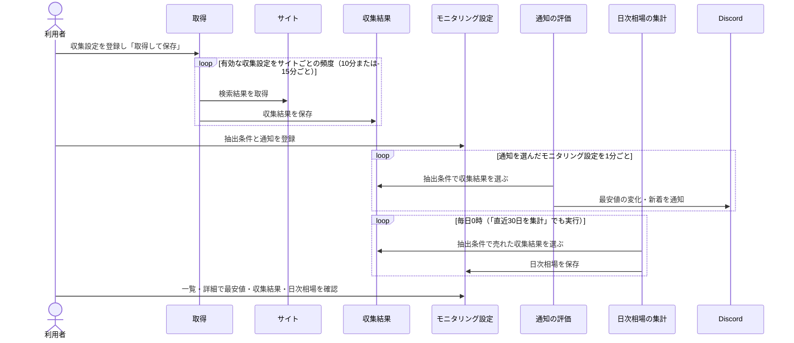
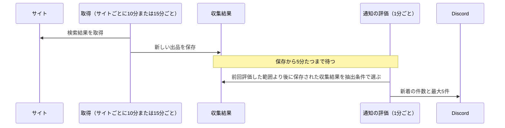

# 商品モニタリングの操作

オペレーション。商品モニタリングを操作する人向けの手順だけを書く。開発環境はホストのリポジトリルートから[ローカル開発](../../development/index.md)に沿って起動し、DB を準備する。画面と通知の振る舞いは[外部仕様](external-spec.md)、エンドポイントは[API](api.md)を参照する。

## 全体の流れ

利用者は収集設定とモニタリング設定を登録し、画面で結果を確認する。取得・通知の評価・日次相場の集計は、それぞれ別のタイミングで自動に動く。収集設定でサイトから集めた収集結果を、モニタリング設定の抽出条件で選び、画面表示・Discord 通知・日次相場に使う。モニタリング設定は特定の収集設定と結び付かず、すべての収集設定の収集結果から選ぶ。そのため、先に収集設定で欲しい商品が集まるようにしてから、モニタリング設定で絞り込む。

## 画面と確認できること

| 画面 | パス | 確認できること | できる操作 |
| --- | --- | --- | --- |
| 収集設定の一覧 | `/product-monitoring/crawl-settings` | 設定ごとの新着最大 8 件の収集結果 | 追加・編集・複製・削除 |
| 収集設定の詳細 | `/product-monitoring/crawl-settings/<id>` | 有効状態・サイト数・検索結果 URL 数・件数、収集結果（販売状態の絞り込みと並び替え） | 設定の編集、取得して保存、収集結果の除外・削除 |
| 収集結果を検索 | `/product-monitoring/crawl-results/search` | 全収集設定の保存済み結果 | 抽出条件による検索、販売状態の切り替え、並び替え、ページ切り替え、検索条件を引き継いだモニタリング設定の登録 |
| モニタリング設定の一覧 | `/product-monitoring/monitors` | 販売中の最安値、直近の平均取引価格、新着順の収集結果 | 追加・編集・複製・削除、収集結果の除外・削除 |
| モニタリング設定の詳細 | `/product-monitoring/monitors/<id>` | 抽出条件、通知の評価状態、収集結果、日次相場 | 条件の編集、販売状態の切り替え、並び替え、もっと見る、直近30日の集計、収集結果の除外・削除 |

画面に出る件数、並び、売り切れの扱いは[外部仕様](external-spec.md)を参照する。売り切れの収集結果は、カードが薄く表示され、売れた日が分かるものは日付が出る。

## 収集設定と取得

1. サイドバーの「収集設定」から `/product-monitoring/crawl-settings` を開き、「収集設定を追加」を選ぶ。既存設定を変更するときは、その設定の「…」メニューの「編集」、または設定名から開いた詳細画面の「設定を編集」を選ぶ。「複製」を選ぶと元の設定値を入れた登録モーダルが開く。
2. 名前と検索ワード・サイト、または検索結果 URL を入力する。検索ワードとサイトは両方必要で、検索結果 URL だけでも登録できる。カテゴリなどは検索結果 URL で指定する。各 URL の横にはホスト名から判定したサイトが表示される。
3. 必要なら保存条件として全検索に共通する必須語・除外語・価格帯を入力し、「登録」または「更新」を選ぶ。
4. 一覧の設定名から詳細画面を開き、「取得して保存」を選ぶ。取得は非同期で実行されるため、しばらくしてから再読み込みし、収集結果を確認する。

登録できる検索結果 URL は次のとおり。

| サイト | URL の形 |
| --- | --- |
| メルカリ | `/search?...` |
| イオシス | `/items?...` |
| じゃんぱら | `/sale/search/result/?KEYWORDS=...` |
| Yahoo!フリマ | `/search/<キーワード>` |
| ヤフオク | `/search/search?...`（出品中）、`/closedsearch/closedsearch?...`（落札相場） |
| トレファク | `/search?...` |

## モニタリング設定と日次相場の確認

検索から登録する場合は、サイドバーの「収集結果を検索」を開いて必須語を入力する。除外語や価格帯を指定するときは「絞り込み」を開き、「絞り込んで検索」を選ぶ。検索結果の「すべて」「販売中」「売り切れ」で販売状態を切り替える。件数、並び、売れた日が無い売り切れの扱いは[外部仕様](external-spec.md#収集結果の検索)を参照する。「この条件でモニタリングを作成」を選ぶと、適用中の検索条件が登録欄に入る。名前を入力し、必要に応じて条件と通知を編集して「登録」を選ぶ。

1. サイドバーの「モニタリング設定」から `/product-monitoring/monitors` を開き、「モニタリング設定を追加」を選ぶ。
2. 名前と抽出条件（必須語・除外語・価格帯）を入力し、受け取りたい通知のチェックボックスを選ぶ。通知は[Discord 通知の受け取り](#discord-通知の受け取り)を参照する。
3. 一覧で販売中の最安値、直近の平均取引価格、新着順の収集結果を確認する。設定の編集・複製・削除もできる。
4. 設定名から詳細を開き、収集結果と日次相場を確認する。「すべて」「販売中」「売り切れ」と並びを切り替え、続きは「もっと見る」を選ぶ。件数、並び、売れた日が無い売り切れの扱いは[外部仕様](external-spec.md#モニタリング設定の詳細)を参照する。日次相場がまだないときは「直近30日を集計」を選ぶ。日次相場の表示期間は 7・14・30 日に切り替えられ、条件も編集できる。

抽出条件を変えると、それまでの日次相場は消え、次の集計で作り直される。

## Discord 通知の受け取り

モニタリング設定の登録・編集画面のチェックボックスで、受け取る通知を選ぶ。届く条件は[外部仕様](external-spec.md#通知)を参照する。

| チェックボックス | 通知 | 届くとき | 届く内容 |
| --- | --- | --- | --- |
| 「最安値の変化を通知する」 | 最安値通知 | 販売中の最安値、または最安値に並ぶ収集結果の組が変わったとき | 最安値の収集結果（最大 5 件） |
| 「新着を通知する」 | 新着通知 | 抽出条件に一致する販売中の収集結果が新しく保存されたとき | 新着の件数と、新しい順に最大 5 件 |

新着が届くまでの待ちは、[外部仕様](external-spec.md#通知)の遅れのとおりである。

通知を受け取るときは次の点に注意する。

- 送信先が未設定か形式が不正なときは、モニタリング設定の詳細に「Discord通知は利用できません。送信先を確認してください。」と表示される。形式が正しければ、Webhook が削除済みなどで送信に失敗しても表示されないので、届かないときは `just logs` で `DiscordWebhook` のエラーを確認する。
- 通知設定の項目（`discord_enabled`）は保存されるが、現行の通知判定はこの項目を参照しない。

通知の判定の詳細は[通知の評価](internal-spec.md#通知の評価)を参照する。

## 収集結果の除外・削除

収集設定の一覧・詳細やモニタリング設定の収集結果のカードの「…」メニューから「除外」または「削除」を選ぶ。どちらもカードの表示元の収集結果に適用される。

| 操作 | 起きること | 元に戻す方法 |
| --- | --- | --- |
| 除外 | 収集結果の行を残したまま、表示・通知・集計から外す。同じ収集設定で再取得しても除外は保たれる | 元の収集設定の更新モーダルで、除外済みの収集結果を展開して個別に取り消す |
| 削除 | 収集結果の行を消す | 取り消せない。サイトの検索結果に残っていれば、次の取得で再び保存される |

同じ出品を別の収集設定も保存していると、そちらの行は除外・削除されないため、モニタリング設定に再び表示されることがある。再取得や日次相場への反映は[抽出と並び](internal-spec.md#抽出と並び)を参照する。
