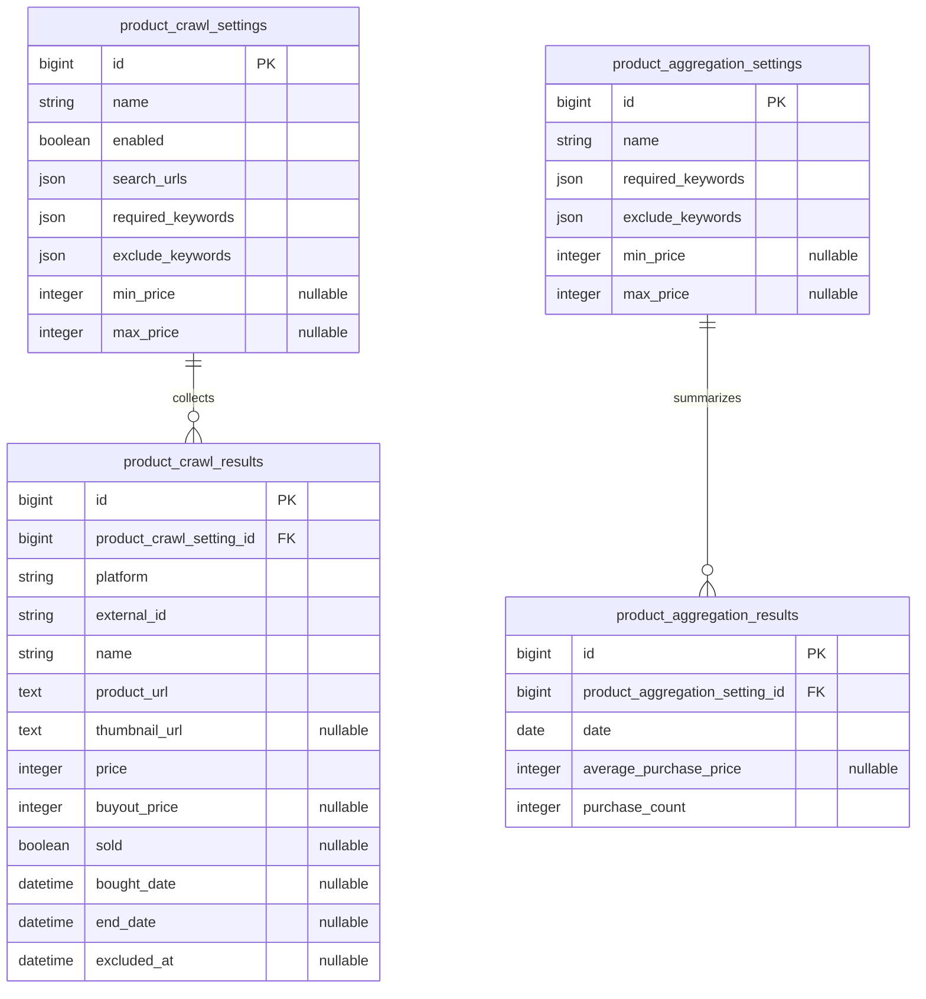

# 商品計測と相場集計の設計

更新: 2026-11-08。

## 方針

- 商品計測設定にクロールしたい検索結果URLを登録し、その結果を商品相場設定ごとに集計する。
- 既存テーブルとは独立した、完全に新規のテーブル群として作る。既存テーブルは参照せず、後で削除する（本計画の範囲外）。
- カテゴリは撤廃する。
- 将来の賃貸ページのクロールと区別するため、テーブル名は `product_`、ドメイン名は「商品」で始める。

## テーブル設計

列は既存テーブルの概念のうち、新構成でも意味を持つものを踏襲する。

### テーブル一覧

| テーブル | ドメイン名 | 役割 |
| --- | --- | --- |
| `product_crawl_settings` | 商品計測設定 | 名前・有効状態、クロールする検索結果URL、URLだけでは絞り込めない追加条件。条件は登録した全URLで共有する |
| `product_crawl_results` | 商品計測結果 | 商品計測設定ごとのクロール結果 |
| `product_aggregation_settings` | 商品相場設定 | 商品計測結果をフィルターする相場集計の条件 |
| `product_aggregation_results` | 商品日次相場 | 商品相場設定ごとの日次集計結果 |

### ER図

### 共通の規則

全テーブルに `created_at`・`updated_at`（NOT NULL）を持つ。以下の列定義では省略する。

列は次の順に並べる。ER図と列定義で同じ順にする。

1. 主キー・外部キー
2. 行を識別する値（名前・サイト・出品ID・集計日）と表示用の値（出品ページURL・サムネイル）
3. 有効状態
4. クロール対象（URL）
5. 条件（必須語・除外語・価格帯）。商品計測設定と商品相場設定で同じ順にする
6. 取得・集計した値。意味の近い列をまとめる（価格と即決価格、販売状態と売れた日時）

必須語・除外語は出品名との部分一致で判定する。商品計測設定と商品相場設定で同じ判定を使う。比べる前に出品名と語句の両方をNFKCで正規化し、小文字にして空白を除く。そのため全角半角・大文字小文字・空白の有無は区別しない（`iPad Pro` は `ｉＰａｄＰｒｏ` に一致する）。

### テーブル定義

#### `product_crawl_settings`（商品計測設定）

名前・有効状態、クロールする検索結果URL、URLだけでは絞り込めない追加条件を持つ。1つの商品計測設定に複数サイトのURLを登録でき、追加条件は全URLのクロール結果に共通で適用する。サイトごとに条件を変える構成は、旧スキーマで使われなかったため採らない。

| 列 | 型 | NULL | 既定値 | 説明 |
| --- | --- | --- | --- | --- |
| `id` | bigint | NO | | 主キー |
| `name` | string | NO | | 商品計測設定名。一覧で設定を見分けるために付ける |
| `enabled` | boolean | NO | `false` | クロール対象にするか。登録した全URLに適用する |
| `search_urls` | json | NO | `[]` | クロールする検索結果URLの文字列配列。設定内の重複は保存時にアプリで検証する |
| `required_keywords` | json | NO | `[]` | 必須語の文字列配列。すべて含む結果だけを保存する |
| `exclude_keywords` | json | NO | `[]` | 除外語の文字列配列。いずれかを含む結果は保存しない |
| `min_price` | integer | YES | | 下限価格。null は制限なし |
| `max_price` | integer | YES | | 上限価格。null は制限なし |

#### `product_crawl_results`（商品計測結果）

商品計測設定ごとのクロール結果。URLには属さず、同じ商品計測設定の複数URLで同じ出品が見つかっても1行にする。別の商品計測設定で見つかれば、商品計測設定ごとに行ができる。

| 列 | 型 | NULL | 既定値 | 説明 |
| --- | --- | --- | --- | --- |
| `id` | bigint | NO | | 主キー |
| `product_crawl_setting_id` | bigint | NO | | 収集元の `product_crawl_settings.id` |
| `platform` | string | NO | | 出品元のサイト。`mercari`・`yahoo_auction`・`yahoo_fleamarket`・`iosys`・`janpara`・`treasure_factory`。表示とサイトごとの絞り込みに使う |
| `external_id` | string | NO | | 出品ID。サイトをまたいでも重複しない |
| `name` | string | NO | | 出品名 |
| `product_url` | text | NO | | 出品ページのURL。クローラーが一覧ページのリンクから保存する |
| `thumbnail_url` | text | YES | | サムネイル画像URL |
| `price` | integer | NO | `0` | 価格 |
| `buyout_price` | integer | YES | | 即決価格。ヤフオクのみ |
| `sold` | boolean | YES | | 売り切れなら `true`、販売中なら `false`。メルカリ・Yahoo!フリマは一覧の売り切れ表示と個別ページの在庫状態から取得し、イオシス・じゃんぱらは一覧に出ていれば `false`。トレファクは一覧に販売中として出ていれば `false` とし、一覧に価格のない売り切れの出品は取り込まない。ヤフオクは出品中の検索で `false`、落札相場で `true` |
| `bought_date` | datetime | YES | | 売れた日。メルカリ・Yahoo!フリマは個別ページの相対表示から日単位で推定した値（各既存クローラーと同じ基準。ただし Yahoo!フリマの「N週間前に更新」は N 週間前とする）。ヤフオクは落札相場の終了日時。表示がない場合とイオシス・じゃんぱら・トレファクは取得しない |
| `end_date` | datetime | YES | | オークション終了日時。ヤフオクのみ |
| `excluded_at` | datetime | YES | | 除外した日時。null なら除外していない。除外しても行は消さず、出品名・商品ページ・画像を残す |

| インデックス | 列 | 一意 |
| --- | --- | --- |
| 商品計測設定と出品ID | `(product_crawl_setting_id, external_id)` | YES |
| 出品ID | `external_id` | NO |

| 外部キー | 参照先 |
| --- | --- |
| `product_crawl_setting_id` | `product_crawl_settings.id` |

`sold: true` かつ `bought_date` が null の行は、個別ページを取得して `bought_date` を埋める対象になる。

除外した出品は、取得し直しても `excluded_at` を残したまま価格などを更新する。結果画面と相場集計では `excluded_at` が null の行だけを使う。

#### `product_aggregation_settings`（商品相場設定）

商品計測設定には紐付けず、全商品計測設定の商品計測結果をフィルターする。フィルターの意味は商品計測設定の追加条件と同じ。

| 列 | 型 | NULL | 既定値 | 説明 |
| --- | --- | --- | --- | --- |
| `id` | bigint | NO | | 主キー |
| `name` | string | NO | | 商品相場設定名 |
| `required_keywords` | json | NO | `[]` | 必須語の文字列配列 |
| `exclude_keywords` | json | NO | `[]` | 除外語の文字列配列 |
| `min_price` | integer | YES | | 下限価格。null は制限なし |
| `max_price` | integer | YES | | 上限価格。null は制限なし |

#### `product_aggregation_results`（商品日次相場）

商品相場設定ごとの日次集計結果。

| 列 | 型 | NULL | 既定値 | 説明 |
| --- | --- | --- | --- | --- |
| `id` | bigint | NO | | 主キー |
| `product_aggregation_setting_id` | bigint | NO | | 集計元の `product_aggregation_settings.id` |
| `date` | date | NO | | 集計日 |
| `average_purchase_price` | integer | YES | | 平均購入価格。購入が0件の日は null |
| `purchase_count` | integer | NO | `0` | 購入件数 |

| インデックス | 列 | 一意 |
| --- | --- | --- |
| 商品相場設定と集計日 | `(product_aggregation_setting_id, date)` | YES |

| 外部キー | 参照先 |
| --- | --- |
| `product_aggregation_setting_id` | `product_aggregation_settings.id` |

### 集計の手順

1. 商品相場設定のフィルターに一致する商品計測結果を、全商品計測設定から取り出す。
2. そのうち `bought_date` が集計日に入る行を対象にする。
3. 複数の商品計測設定に同じ出品の行がある場合は、`external_id` で1件にまとめる。
4. 平均価格と件数を商品日次相場に `(product_aggregation_setting_id, date)` 単位で保存する。

## 画面設計（ドラフト）

テーブル設計とPoC（[商品計測・商品相場PoC](../../backend/product-monitoring-poc.md)）の操作から起こした叩き台。PoCで実装しながら詰める。

### 画面一覧

| 画面 | 対象テーブル | 主な操作 |
| --- | --- | --- |
| 商品計測設定の登録・編集（モーダル） | `product_crawl_settings` | 名前・URL・追加条件の入力、保存。更新では除外した出品の確認と取り消し |
| 商品計測結果一覧 | `product_crawl_results` | 設定の追加・編集・複製・削除。設定ごとに新着の数件を表示し、出品の除外と詳細への遷移 |
| 商品計測結果詳細 | `product_crawl_results` | 有効状態・URL数・件数と1つの商品計測設定の全件を表示。販売状態の絞り込み、並び替え、取得して保存、出品の除外 |
| 商品相場設定の登録・編集（モーダル） | `product_aggregation_settings` | 名前・フィルターの入力、保存 |
| 商品相場 | `product_aggregation_results`・`product_crawl_results` | 設定の追加・編集・削除と条件のバッジ表示。全商品相場設定の日次推移を設定ごとのセクションで表示。要約の数値、期間とグラフ・表の切り替え、集計の実行、相場対象の商品のカード |

### 商品計測結果詳細の設定表示

| 表示項目 | 元の列 |
| --- | --- |
| 名前 | `name` |
| 有効状態 | `enabled` |
| URL数 | `search_urls` の要素数 |
| 件数 | 商品計測結果の件数 |

「…」メニューの「複製」は、元の設定値（名前の末尾に「（コピー）」を付ける）を入れた登録モーダルを開き、「登録」で新しい商品計測設定として保存する。商品計測結果と除外した出品は複製しない。

### 商品計測設定の登録・編集

| 入力項目 | 元の列 | 入力方法 |
| --- | --- | --- |
| 名前 | `name` | 必須 |
| 有効状態 | `enabled` | 切り替え |
| 検索結果URL | `search_urls` | 複数入力。URLのホスト名から判定したサイトを各URLの横に表示する |
| 必須語 | `required_keywords` | 複数入力。すべて含む結果だけを保存する |
| 除外語 | `exclude_keywords` | 複数入力。いずれかを含む結果は保存しない |
| 価格帯 | `min_price`・`max_price` | 上下限。空欄は制限なし |

更新で必須語・除外語・価格帯を変えると、保存済みの商品計測結果のうち新しい条件に一致しないものを削除する。

除外する出品はこの画面では入力せず、商品計測結果で出品を選ぶ。更新では除外した出品を画像・名前・商品ページへのリンクつきで並べ、その場で取り消せる。

### 商品計測結果

一覧では設定の追加と各設定の編集・複製・削除ができ、商品計測設定ごとに新着の数件を並べ、詳細で1つの設定の全件を並べる。

| 表示項目 | 元の列 |
| --- | --- |
| 画像 | `thumbnail_url` |
| サイト | `platform` |
| 出品名 | `name`。`product_url` へのリンク |
| 価格・即決価格 | `price`・`buyout_price` |
| 販売状態・売れた日時 | `sold`・`bought_date` |
| オークション終了日時 | `end_date` |

詳細から「取得して保存」を実行できる。カードの「…」メニューから出品を除外できる。除外すると商品計測結果の `excluded_at` に日時を入れる。行は消さない。

### 商品相場設定の登録・編集

| 入力項目 | 元の列 | 入力方法 |
| --- | --- | --- |
| 名前 | `name` | 必須 |
| 必須語 | `required_keywords` | 複数入力 |
| 除外語 | `exclude_keywords` | 複数入力 |
| 価格帯 | `min_price`・`max_price` | 上下限。空欄は制限なし |

相場画面の各セクションは名前と条件のバッジ（必須語・除外語・価格帯）を表示し、「…」メニューから編集・削除する。

### 商品相場

全商品相場設定の日次の推移を、設定ごとのセクションに表示する。設定の追加と各設定の編集・削除ができる。各セクションから直近30日の集計を実行できる。

| 表示項目 | 元の列 |
| --- | --- |
| 集計日 | `date` |
| 平均購入価格 | `average_purchase_price` |
| 購入件数 | `purchase_count` |

日次推移の下に、表示期間（7・14・30日）に売れた相場対象の商品を、商品計測結果と同じカードで売れた日の新しい順に並べる。対象は[集計の手順](#集計の手順)の1〜3と同じ条件で、画面を開いたときの商品計測結果から取り出す。そのため集計後に売れた日が分かった出品などは、再集計するまで購入件数と一致しないことがある。

### 未決事項

- 旧設定画面のURL `/admin/product-crawl-settings`・`/admin/product-aggregation-settings` は、それぞれ `/product-crawl-results`・`/product-aggregation-results` へリダイレクトする。
- 商品相場の表示形式（グラフ・表）と表示期間。
